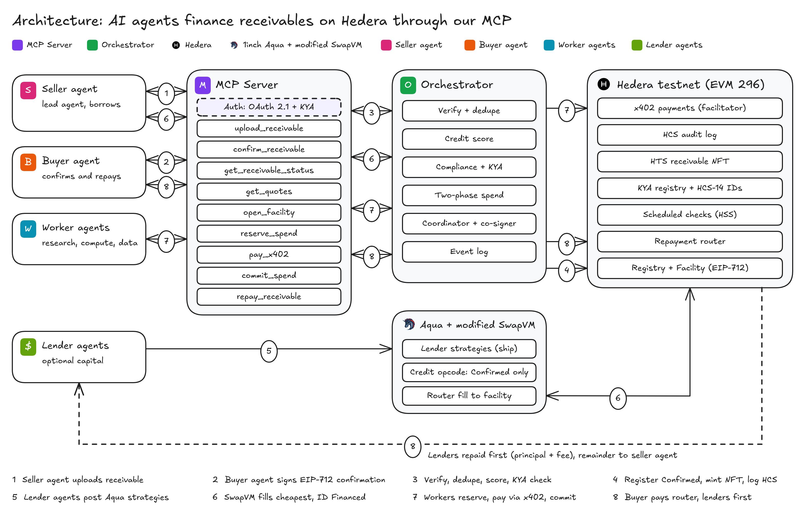

# BUILD.md: Autonomous Working Capital on Hedera

The plan and system design for building the project from scratch. It replaces the Arc and ATS design. Read `context.md` for the decisions log. This file explains how to build it.

**One line:** a seller agent turns a buyer-agent-signed receivable into USDC working capital that its worker agents can spend through x402. When the buyer agent pays, lenders are repaid first, automatically.

**One verified receivable, one shared credit ceiling, many agents.**



The editable source is `diagrams/architecture-hedera.excalidraw` (open it at excalidraw.com).

---

## Contents

1. [Scope and prize targets](#1-scope-and-prize-targets)
2. [Decisions](#2-decisions)
3. [Architecture](#3-architecture)
4. [Actors, identity and KYA](#4-actors-identity-and-kya)
5. [MCP server and KYA authorization](#5-mcp-server-and-kya-authorization)
6. [Receivable verification (EIP-712)](#6-receivable-verification-eip-712)
7. [Smart contracts on Hedera EVM](#7-smart-contracts-on-hedera-evm)
8. [Aqua and the modified SwapVM on Hedera](#8-aqua-and-the-modified-swapvm-on-hedera)
9. [Agent spending through x402](#9-agent-spending-through-x402)
10. [Repayment waterfall](#10-repayment-waterfall)
11. [Off-chain services](#11-off-chain-services)
12. [Data, events and error codes](#12-data-events-and-error-codes)
13. [Repository layout](#13-repository-layout)
14. [Build phases](#14-build-phases)
15. [Testing](#15-testing)
16. [Demo script](#16-demo-script)
17. [Configuration and addresses](#17-configuration-and-addresses)
18. [Developer tooling: Hedera and 1inch connectors](#18-developer-tooling-hedera-and-1inch-connectors)
19. [Risks and open questions](#19-risks-and-open-questions)
20. [What we reuse from the current codebase](#20-what-we-reuse-from-the-current-codebase)
21. [Sources](#21-sources)

---

## 1. Scope and prize targets

| Track | Prize | What qualifies us |
|---|---|---|
| Hedera: AI Agents That Pay (x402) | $6,500 | Our own x402-protected endpoint (a paid research API) settles USDC on Hedera testnet through a listed facilitator. A worker agent finds it and pays with no human approval. The README gives the HashScan transaction ID. |
| 1inch: Build an Aqua App | $5,000 | We redeploy the official Aqua registry and a **modified SwapVM** router (new credit opcode) on Hedera testnet. Lender strategies are filled on-chain, and token transfers show on HashScan. Commits are spread across the event. |

**Extra points we aim for**

| Track | Extra point | How |
|---|---|---|
| x402 | Spending controls | Per-agent budgets, per-transaction and daily limits, merchant allowlist, a facility-wide ceiling, and a policy co-signer that must approve every payment |
| x402 | Agent identity and reputation (HCS-14 or ERC-8004) | HCS-14 UAIDs for every agent, plus an ERC-8004-shaped on-chain `KYARegistry` that holds KYA level and repayment reputation |
| x402 | HCS audit log | Every lifecycle event and payment goes to one HCS topic, hashes only |
| x402 | Settling in an HTS token | Testnet USDC (HTS `0.0.429274`) |
| x402 | Scheduled Transactions | The facility schedules its own overdue and default checks through the Hedera Schedule Service (HIP-1215) |
| x402 | Hedera Agent Kit | Agents use the Agent Kit (TypeScript) for HTS and HCS calls |
| x402 | Multi-agent negotiation (optional) | Seller and buyer agents agree terms before the buyer signs |
| Aqua | Projects that use SwapVM score higher | A custom `RECEIVABLE_CREDIT` opcode that gates every fill on the on-chain receivable state |

**Out of scope:** ATS, Arc, production KYC, fiat rails, governance, liquidations, sybil resistance beyond the demo allowlist.

---

## 2. Decisions

| # | Decision | Why |
|---|---|---|
| D1 | No ATS. Receivables are proven by a **buyer-signed EIP-712 confirmation** plus an on-chain registry. | The buyer's own signature is stronger evidence than a token we mint ourselves |
| D2 | No Arc. **Everything runs on Hedera testnet** (EVM chain ID 296). | One chain removes the cross-chain bridge. Lock and lend happen in one transaction. |
| D3 | We **redeploy Aqua and a modified SwapVM** on Hedera testnet. | Aqua is not deployed on Hedera. The track rules allow "redeployments of a modified SwapVM contract". |
| D4 | The only entities are **agents**: seller, buyer, worker and lender agents. | Matches the product |
| D5 | Lenders are optional. The demo uses scripted lender agents. | The protocol must not depend on one capital source |
| D6 | The buyer confirmation is the root of trust. | Nothing is financeable without it |
| D7 | **MCP auth = OAuth 2.1 (MCP spec) with KYA at the authorization server.** | The MCP spec forbids passing third-party tokens through, so KYA proofs are exchanged for our own audience-bound token (section 5) |
| D8 | Worker agents pay from **2-of-2 threshold-key spend wallets** funded just in time by the facility. | x402 on Hedera debits the client's own account, so a contract cannot pay directly. The threshold key keeps the policy engine in the loop (section 9). |
| D9 | Overdue and default checks are **scheduled on-chain** with HIP-1215. | No keeper bot is needed |
| D10 | Credit decisions stay deterministic. | AI explains a decision but never approves one |

---

## 3. Architecture

### 3.1 Components

| Layer | Component | Responsibility |
|---|---|---|
| Agents | Seller, buyer, worker and lender agents | MCP clients. Each has an ECDSA key, a Hedera account, an HCS-14 UAID and a KYA level. |
| Access | **MCP server** | Tool surface for every agent. OAuth 2.1 resource server. Checks scopes and roles per tool. |
| Access | **Authorization server** | Issues short-lived, audience-bound tokens after a KYA proof (section 5) |
| Brain | **Orchestrator** | Verify and dedupe, credit score, compliance and KYA, two-phase spend, coordinator signer, payment co-signer, event log |
| Hedera EVM | `KYARegistry` | Agent identity, KYA level, owner group, repayment reputation (ERC-8004-shaped) |
| Hedera EVM | `ReceivableRegistry` | Verifies the EIP-712 confirmation. Canonical ID. State machine. |
| Hedera EVM | `CreditFacility` + `ReceivableCreditNote` | Funds receivables through Aqua, holds the USDC, manages budgets and reservations, schedules checks |
| Hedera EVM | `RepaymentRouter` | Takes the buyer's payment and runs the waterfall: lenders first, then the seller |
| Hedera EVM | Aqua registry + `AquaCreditSwapVMRouter` | Official Aqua plus SwapVM with our credit opcode |
| Hedera native | HTS | Testnet USDC, and one receivable NFT per receivable (a handle, not a source of truth) |
| Hedera native | HCS | Audit topic, HCS-14 agent profiles |
| Hedera native | HSS (`0x16b`) | Scheduled `markOverdue` and `markDefaulted` calls |
| Hedera native | x402 facilitator | Verifies and settles worker payments (Blocky402, x402.org or Launa testnet) |
| Merchants | Paid research API | Our x402-protected endpoint (and any other x402 service) |
| UI | Dashboard | Shows the eight steps, the evidence links and the waterfall |

### 3.2 End-to-end flow (matches the diagram numbers)

1. **Seller agent** calls `upload_receivable`. It gets a pending ID and a confirmation request for the buyer.
2. **Buyer agent** signs the EIP-712 `ReceivableConfirmation` (payee = repayment router) and calls `confirm_receivable`.
3. **Orchestrator** verifies the signature, KYA levels and owner separation, dedupes the canonical ID and computes the credit score and borrowing base.
4. The orchestrator calls `ReceivableRegistry.register`, so the state becomes `Confirmed`. It mints the HTS receivable NFT and logs to HCS.
5. **Lender agents** have shipped Aqua strategies (APR, max advance, max tenor, min buyer reputation).
6. The seller agent calls `open_facility`. The coordinator calls `CreditFacility.openAndFund`, which fills the cheapest eligible strategies through the modified router. The credit opcode checks `Confirmed`, and the facility marks the ID `Financed`, all **in one transaction**.
7. **Worker agents** call `reserve_spend`, then `pay_x402`, then `commit_spend`. The facility funds the worker's spend wallet with exactly the reserved amount. The co-signer approves the matching x402 transfer, and the facilitator settles it in USDC.
8. **Buyer agent** calls `repay_receivable`. The router pays lenders (principal plus fee) first and the seller agent the rest. The ID becomes `Repaid` and both agents' reputation is updated.

The demo also shows a duplicate submission of the same obligation being rejected with `DUPLICATE_RECEIVABLE`.

### 3.3 Why one chain matters

On Arc plus Hedera we needed a coordinator attestation to carry Hedera facts to Arc. Now `register`, `openAndFund`, `reserve`, `repay` and the NFT and HCS writes all happen on one network. The only off-chain trust left is in two places:

- **The coordinator.** It submits `openAndFund` and `reserve`, and the contracts re-check every limit.
- **The policy co-signer** on spend wallets. It can refuse a payment but cannot move funds alone.

---

## 4. Actors, identity and KYA

### 4.1 Agent identity

Every agent has:

- an **ECDSA secp256k1 key**, plus a Hedera account with an EVM alias. ECDSA is required so `ecrecover` and EVM tools work.
- an **HCS-14 UAID**, with its profile published to HCS. This is already implemented in our TS and Python code.
- a **`KYARegistry` entry**: role, KYA level, owner-group hash, expiry and revocation flag.

### 4.2 KYA levels

| Level | Requirement | Allowed |
|---|---|---|
| 0 | Unknown key | Nothing |
| 1 | Key proven, UAID registered | Read tools only |
| 2 | Level 1, plus an owner KYC/KYB reference (hash only) and a signed **mandate** from the owner | Seller: upload and borrow up to the Starter limit. Worker: spend within a reservation. |
| 3 | Level 2, plus an external KYA attestation (Skyfire `kya` token or a DIF KYA-OS credential) or a repayment history | Higher credit tiers. Can act as a **buyer** agent. |

A **buyer agent needs level 3**, or an allowlisted reputation in the demo. A fake buyer is the main fraud risk (see `context.md` section 5.8).

### 4.3 Fake-buyer controls

- **Owner separation.** `KYARegistry.ownerGroup(buyer) != ownerGroup(seller)`, enforced in `register`.
- **Reputation threshold** before a buyer can confirm. Repayments update reputation on-chain and on HCS.
- **Per-buyer exposure cap** in the borrowing base and in each lender's strategy.
- **Demo setup:** one pre-registered buyer agent with reputation. We state plainly that sybil resistance is the next layer.

### 4.4 Mandate (owner → agent delegation)

A mandate is an EIP-712 message signed by the owner key:

```
AgentMandate(address agent, uint8 role, uint256 maxPerTx, uint256 maxDaily,
             address[] merchants, uint64 expiresAt, uint256 nonce)
```

Its hash is stored in `KYARegistry` and published to HCS. The orchestrator enforces the mandate. The facility enforces the numeric limits again.

---

## 5. MCP server and KYA authorization

**Short answer: yes, KYA can drive MCP auth.** It has to follow the MCP authorization spec, though. KYA proofs are checked at **our authorization server**, which then issues our own token. The MCP server never accepts a third-party KYA token directly. The spec requires servers to accept only tokens issued for them, and it forbids token passthrough.

### 5.1 What the MCP spec (2025-11-25) requires

- The MCP server is an OAuth 2.1 resource server. It serves Protected Resource Metadata (RFC 9728) and answers `401` with `WWW-Authenticate: Bearer resource_metadata=…, scope=…`.
- Clients send `resource=` (RFC 8707) and use PKCE S256. The server validates the audience and rejects tokens issued for other resources.
- Insufficient scope returns `403` with `error="insufficient_scope"`. This is the step-up hook for high-risk tools.

### 5.2 Our flow

```
Agent ──(1) MCP call, no token──────────────▶ MCP server ──401 + resource_metadata
Agent ──(2) GET /.well-known/oauth-protected-resource ─▶ authorization_servers=[AS]
Agent ──(3) token request to AS:
        grant_type = urn:ietf:params:oauth:grant-type:jwt-bearer (RFC 7523)
        assertion  = JWT signed by the agent's ECDSA key
                     { iss: agentAddress, sub: UAID, aud: AS, jti, exp, mandateHash,
                       kya_evidence?: <Skyfire kya+jwt | KYA-OS VC> }
        resource   = https://mcp.<domain>/mcp
AS:  verify signature against KYARegistry key, KYA level, mandate, revocation;
     if kya_evidence: verify issuer JWKS (Skyfire: iss + /.well-known/jwks.json,
     typ kya+jwt, aud, exp) or the VC proof, then raise the level.
AS ──(4) access token (5-15 min, audience = MCP URL):
        { sub: UAID, agent: 0x…, role, kya_level, owner_group, scope, cnf.jkt? }
Agent ──(5) MCP calls with Authorization: Bearer … (optional DPoP, RFC 9449)
```

- **Human-operated MCP clients** (Claude Desktop, IDEs): the standard authorization-code + PKCE flow. The **owner** logs in and grants scopes to the agent, and the AS links the session to the agent's `KYARegistry` entry.
- **Token passthrough is never allowed.** For example, if the MCP server calls the 1inch API, it uses its own server-side credentials.

### 5.3 Tools, roles and scopes

| Tool | Role | Scope | On-chain effect | Step-up |
|---|---|---|---|---|
| `register_agent` | owner (human) | `agent:admin` | `KYARegistry.register`, HCS-14 profile | always |
| `upload_receivable` | seller | `receivable:write` | none (pending) | – |
| `confirm_receivable` | buyer | `receivable:confirm` | `ReceivableRegistry.register`, NFT mint, HCS | – (the EIP-712 signature is the consent) |
| `get_receivable_status` | any | `receivable:read` | – | – |
| `get_quotes` | seller | `credit:read` | – | – |
| `open_facility` | seller | `facility:open` | `CreditFacility.openAndFund` | above the mandate limit |
| `set_budgets` | seller | `budget:write` | `CreditFacility.setBudgets` | – |
| `reserve_spend` | seller or worker | `spend:reserve` | `CreditFacility.reserve` (funds the spend wallet) | above `maxPerTx` |
| `pay_x402` | worker | `spend:pay` | x402 settle (co-signed) | – |
| `commit_spend` | worker | `spend:commit` | `CreditFacility.commit` | – |
| `repay_receivable` | buyer | `repay:write` | `RepaymentRouter.repay` | – |
| `explain_decision` | any | `credit:read` | – (AI explanation of a deterministic decision) | – |

Every state-changing tool also needs an **idempotency key**. Every call is logged with the token's `sub` and `jti`.

**Optional extra for the x402 track:** charge per call for `get_quotes` through x402 (a metered MCP tool).

---

## 6. Receivable verification (EIP-712)

### 6.1 Typed data

```solidity
// Domain: name "AgentReceivables", version "1", chainId 296, verifyingContract = ReceivableRegistry
struct ReceivableConfirmation {
    address seller;            // seller agent EVM address
    address buyer;             // buyer agent EVM address (the signer)
    address currency;          // USDC ERC-20 facade address
    uint256 amount;            // in token base units (USDC has 6 decimals)
    uint64  dueDate;           // unix seconds
    bytes32 buyerRef;          // buyer's PO / AP reference (hashed if sensitive)
    bytes32 detailsCommitment; // keccak256(invoiceDocHash, salt)
    address payTo;             // MUST equal RepaymentRouter
    uint256 nonce;             // per-buyer
    uint64  deadline;          // the signature expires
}
```

### 6.2 Canonical ID

```
id = keccak256(abi.encode(buyer, buyerRef))
```

The ID is keyed on the **buyer's** reference, so a reworded copy of the same obligation collides. Changing the amount, the date or the document does not create a new ID.

### 6.3 Registry rules (`register`)

1. `state[id] == None`, or revert `DUPLICATE_RECEIVABLE`.
2. `ECDSA.recover(_hashTypedDataV4(...)) == buyer`, or revert `BAD_BUYER_SIG`.
3. `payTo == repaymentRouter`, or revert `WRONG_PAYEE`.
4. `block.timestamp <= deadline` and `dueDate` within 1–120 days, or revert `TERM_INELIGIBLE`.
5. `nonces[buyer] == nonce`, then increment, or revert `BAD_NONCE`.
6. `kya.level(buyer) >= 3`, `kya.level(seller) >= 2`, not revoked, or revert `KYA_FAIL`.
7. `kya.ownerGroup(buyer) != kya.ownerGroup(seller)`, or revert `SELF_DEALING`.
8. Set `state[id] = Confirmed` and store `{seller, buyer, amount, dueDate, commitment}`. Emit `Registered`.

The **state machine** is `None → Confirmed → Financed → Repaid`, with exits to `Overdue → Defaulted` and `Cancelled` (buyer and seller co-sign, and only before `Financed`). Only the facility can set `Financed`. Only the router can set `Repaid`.

### 6.4 HTS receivable NFT

The orchestrator mints one NFT **after** `Registered` (Hedera SDK or Agent Kit), with `id` and the HCS sequence in its metadata (100 bytes or less). It is a handle for wallets and explorers. **The registry is the source of truth.**

### 6.5 Privacy

Only `detailsCommitment`, amounts and states go on-chain. The invoice document and its salt are shared off-chain with matched lenders only.

### 6.6 Stretch: India GST e-invoice

The GST code we already built can be added as **extra evidence** and does not replace the buyer signature:

- GSTIN check digits, same-PAN block and IRN recomputation.
- An IRN could become the `buyerRef` for a cross-registry check (future work).

---

## 7. Smart contracts on Hedera EVM

Solidity 0.8.2x with Foundry. Use `evm_version = "cancun"`: Hedera supports Cancun and Pectra opcodes, including `TSTORE`, `TLOAD` and `MCOPY`. Use `call` (not `delegatecall`) for system contracts.

### 7.1 Hedera specifics to design around

| Topic | Rule |
|---|---|
| HTS USDC in contracts | Use it through its **ERC-20 facade** (HIP-218 and HIP-376) at its long-zero EVM address. `approve` and `transferFrom` work. |
| Token association | Every contract that receives USDC (`CreditFacility`, `RepaymentRouter`, and the router if it ever holds funds) must associate with USDC. Call `IHRC719(usdc).associate()` in the constructor (HIP-719), or associate through the SDK after deploy. **The most common cause of failed transfers.** |
| HBAR decimals | 8 decimals natively, but the JSON-RPC relay shows 18. Only matters for gas and HSS funding. |
| `block.timestamp` | The consensus timestamp. Use it for everything time-based. Never use `block.number`. |
| `tx.origin` | The account paying for the transaction |
| Scheduled calls | `HSS (0x16b).scheduleCall(to, expirySecond, gasLimit, value, data)` (HIP-1215, live on testnet since v0.68). The maximum horizon is **62 days**. The contract needs HBAR to pay. |
| Rent | Contracts pay auto-renew rent. Keep a small HBAR balance or set an auto-renew account. |
| Large contracts | Jumbo Ethereum transactions (HIP-1086) carry big bytecode, so deploying SwapVM through the relay should work. Verify in Phase 0. |

### 7.2 `KYARegistry` (ERC-8004-shaped)

```solidity
struct Agent { bytes32 uaidHash; bytes32 ownerGroup; uint8 role; uint8 level;
               uint64 expiresAt; bool revoked; bytes32 mandateHash; }
function register(address agent, Agent calldata a) external onlyIssuer;
function setLevel(address agent, uint8 level) external onlyIssuer;
function revoke(address agent) external onlyIssuer;
function level(address agent) external view returns (uint8);   // 0 if expired or revoked
function ownerGroup(address agent) external view returns (bytes32);
// reputation (written by RepaymentRouter only)
function recordRepayment(address buyer, address seller, bool onTime) external onlyRouter;
function reputation(address agent) external view returns (uint32 onTime, uint32 late, uint32 defaults);
```

ERC-8004 has no Hedera deployment that we found, so we deploy this minimal version and link each entry to its HCS-14 UAID.

### 7.3 `ReceivableRegistry`

The functions are `register(conf, sig)`, `markFinanced(id)` (facility only), `markRepaid(id)` (router only), `markOverdue` and `markDefaulted` (facility only, after the due date), `cancel(id, sellerSig, buyerSig)`, and `state(id)` / `get(id)` views. The rules are in section 6.3.

### 7.4 `CreditFacility`

One contract holds many facilities, keyed by receivable `id`.

```solidity
struct Fill { bytes order; address maker; uint256 amount; uint16 aprBps; }

function openAndFund(bytes32 id, Fill[] calldata fills, uint16 advanceBps,
                     uint256 limit, bytes calldata coordinatorSig) external onlyCoordinator;
// 1. require registry.state(id) == Confirmed
// 2. borrowing base: sum(fills.amount) <= amount * advanceBps / 1e4 and <= limit
//    (advanceBps and limit come from the off-chain score, signed by the coordinator)
// 3. require fills to be sorted by aprBps ascending (cheapest first)
// 4. TSTORE(activeId, id); for each fill: approve router for the note amount, then
//    router.swap(order, note, USDC, amount, takerData = abi.encode(id))
//    -> the credit opcode checks the state and calls onCreditFill (section 8)
// 5. registry.markFinanced(id); TSTORE(activeId, 0)
// 6. schedule markOverdue at dueDate + 7 days and markDefaulted at dueDate + 30 days via HSS
// any failure reverts everything, so no partial funding

function onCreditFill(bytes32 id, address maker, uint256 usdcIn, uint16 aprBps) external onlyRouter;
// require TLOAD(activeId) == id; record position[id][maker] = {principal, aprBps, start}

function setBudgets(bytes32 id, address[] calldata workers, uint256[] calldata alloc,
                    Limits[] calldata limits) external; // msg.sender == seller; sum(alloc) <= funded
function reserve(bytes32 id, bytes32 spendId, address worker, address merchant,
                 uint256 amount, uint64 expiry) external onlyCoordinator;
// checks: active, worker budget, per-tx, daily, merchant allowlist, facility ceiling.
// Moves `amount` USDC to the worker's spend wallet (just in time).
function commit(bytes32 spendId, bytes32 hederaTxIdHash) external onlyCoordinator;
function release(bytes32 spendId) external; // after expiry or failure: transferFrom(wallet -> facility)
                                            // using the wallet's standing HTS allowance
function markOverdue(bytes32 id) external;   // also callable by HSS; permissionless after the grace period
function markDefaulted(bytes32 id) external;
function flagDispute(bytes32 id) external;   // freezes spending
function pause() external onlyOwner;         // never blocks repayment
```

`ReceivableCreditNote` (RCN) is a plain ERC-20 used as the **taker leg** of each Aqua fill (1 RCN = 1 USDC of principal).

- The facility mints it, and only the router may burn it.
- Transfers are allowed only from or to the facility and the Aqua contracts, so lenders cannot resell it.
- It is not an HTS token, so it needs no association.

### 7.5 `RepaymentRouter`

```solidity
function repay(bytes32 id, uint256 amount) external;  // buyer: USDC.transferFrom(buyer -> router)
// waterfall (section 10): lenders pro rata (principal + fee) -> seller remainder
// burns RCN, closes positions, registry.markRepaid(id) when debt == 0,
// kya.recordRepayment(buyer, seller, onTime), deletes the HSS schedules
```

Partial payments go to lenders first. A payment after a default still reaches lenders first.

### 7.6 Invariants (fuzz and invariant tests)

- `debt(id) <= borrowingBase(id)` always.
- `sum(budgets) <= funded`. More agents never means more credit.
- The seller receives nothing while any lender is owed.
- `state` only moves forward along the allowed edges, and `Financed` is set in the same transaction as the fills.
- Committed plus reserved plus available equals funded, for every facility.

---

## 8. Aqua and the modified SwapVM on Hedera

### 8.1 What we deploy

| Contract | Source | Notes |
|---|---|---|
| Aqua registry | `github.com/1inch/aqua` (official) | Deploy unmodified. The license is `LicenseRef-Degensoft-Aqua-Source-1.1` (source-available), so **confirm with the 1inch team** that a testnet redeploy is fine. |
| `AquaCreditSwapVMRouter` | `github.com/1inch/swap-vm` (official) + our opcode | `AquaSwapVMRouter` with one extra instruction. Constructor `(aqua, weth = WHBAR, owner, name, version)`. |

The addresses will **not** match 1inch's vanity addresses (`0x1111113c…`). Pass our addresses to the SDK: `new AquaProtocolContract(new Address(OUR_AQUA))`.

### 8.2 The credit opcode

`_receivableCredit(args)` runs first in each lender's program, after `_deadline`:

```
args = { registry, facility, maxAdvanceBps, maxTenorDays, minBuyerOnTime, maxPerBuyer, aprBps }
check:
  taker == facility                            (only our facility can fill)
  id = decode(takerData)
  registry.state(id) == Confirmed              (the core rule)
  dueDate - now <= maxTenorDays
  requested advance <= maxAdvanceBps
  kya.reputation(buyer).onTime >= minBuyerOnTime
  makerExposure(buyer) + amount <= maxPerBuyer
then:
  price 1 RCN : 1 USDC (pegged 1:1, no fee band)
  call facility.onCreditFill(id, maker, amount, aprBps)
```

Each lender sets its own risk rules and APR in its strategy. The facility can only borrow from strategies whose rules the receivable passes.

The default 1inch taker gate (`_onlyTxOriginTokenBalanceNonZero(KycNFT)`) is not used. Our opcode restricts the taker to the facility instead.

### 8.3 Lender flow

1. Associate with USDC, and approve the **Aqua registry** for USDC through the facade.
2. Build the program with `@1inch/swap-vm-sdk`, using our opcode index and arguments.
3. Call `ship(app = AquaCreditSwapVMRouter, strategy, [{ USDC, amount }])` with `@1inch/aqua-sdk`.

The USDC stays in the lender's wallet until a fill.

### 8.4 Solver (off-chain, deterministic)

1. Read the open strategies from `Shipped` events.
2. Simulate each strategy's guard with `eth_call` against the receivable.
3. Sort the eligible strategies by `aprBps` ascending, and fill until the borrowing base or the limit is reached.

Worked example: A $4,000 at 7% and B $2,000 at 8.5% are filled. C at 13% is not needed.

---

## 9. Agent spending through x402

### 9.1 The constraint

In Hedera's `exact` scheme, the client signs a `TransferTransaction` that debits **its own account**, and the facilitator pays the fee as `feePayer`. A contract cannot sign that transaction, so the facility cannot be the x402 payer.

The facilitator must also verify that the payer signed, and it checks against the payer's on-chain key, **including KeyList and threshold keys**.

### 9.2 Design: co-signed spend wallets

- Each worker agent has a **spend wallet**: a Hedera account with a **2-of-2 threshold key** {worker key, policy co-signer key}.
- The wallet is associated with USDC and grants the facility a standing USDC allowance, so `release` can pull unspent funds back.
- The wallet holds **zero balance** between payments.

| Phase | Who | What happens |
|---|---|---|
| Reserve | `reserve_spend` → coordinator → `CreditFacility.reserve` | The limits are checked twice (engine, then contract). Exactly `amount` USDC moves to the spend wallet. HCS `SpendReserved`. |
| Pay | `pay_x402` | The worker calls the merchant and gets `402` with `PaymentRequirements` (USDC, amount, `payTo`, `feePayer`). The worker builds and signs the transfer. The **co-signer** adds its signature only if `payTo`, asset and amount match the reservation and the merchant is allowlisted. The request is retried with the payment header, and the facilitator `/verify`s and `/settle`s it. |
| Commit | `commit_spend` → `CreditFacility.commit(spendId, txIdHash)` | Records the Hedera transaction ID and posts HCS `SpendCommitted`, with a HashScan link in the dashboard |
| Release | timeout or failure | `release` pulls the unspent USDC back through the allowance. HCS `SpendReleased`. |

**Rejections:**

- **Engine:** `AGENT_BUDGET_EXCEEDED`, `TX_LIMIT_EXCEEDED`, `DAILY_LIMIT_EXCEEDED`, `MERCHANT_NOT_ALLOWED`, `GLOBAL_CREDIT_LIMIT_EXCEEDED`.
- **Contract:** reverts with the same names.
- **Co-signer:** refuses any transfer that does not match an open reservation.

**Fallback if threshold-key signing does not work with the x402 client library:** use a single-key spend wallet funded just in time with the exact amount. The exposure is then capped at one payment.

### 9.3 Our x402 merchant (for the prize)

- `GET /research?topic=…` costs $0.25 USDC on `hedera:testnet`.
- It uses `@x402/hedera` server middleware with a **listed facilitator**: `https://api.testnet.blocky402.com`, `https://x402.org/facilitator` or `https://testnet.facilitator.launa.dev`.
- The merchant account must be associated with USDC.
- Discovery: the worker reads a small service catalog (or the 402 response) and compares prices before paying. This covers the "agent finds the endpoint" requirement.

---

## 10. Repayment waterfall

```
fee_i      = principal_i * apr_i * max(elapsed, minTerm) / 365 days
lenderDue  = sum(principal_i + fee_i)
payment    -> lenders pro rata until lenderDue is paid -> seller agent remainder
undrawn    -> USDC still in the facility goes to the seller agent on close
```

**Worked example** (30-day minimum term):

| Item | Amount |
|---|---|
| Receivable | $10,000, Net 30. 75% advance gives a $7,500 borrowing base. |
| Funded | A $4,000 at 7%, plus B $2,000 at 8.5%, gives $6,000 |
| Budgets | Research $1,000, Compute $3,000, Data $1,000, Reserve $1,000 |
| Fees | A $23.01, B $13.97 |
| Buyer pays $10,000 | Lenders 6,036.9863 USDC (about $6,036.99), seller agent about $3,963.01, plus the undrawn credit |

The brief's flat "$100 fee" was only an illustration. The contract uses the formula above.

The compute agent's $5,500 request fails with **`AGENT_BUDGET_EXCEEDED`**, because its budget is $3,000. To show `GLOBAL_CREDIT_LIMIT_EXCEEDED`, send a separate request above the facility's remaining capacity.

**On time, late and default:**

- Spending stops at the due date.
- `markOverdue` at +7 days and `markDefaulted` at +30 days, both scheduled via HSS and also permissionless.
- Repayment always works and always pays lenders first.

---

## 11. Off-chain services

| Service | Stack | Responsibilities |
|---|---|---|
| `apps/mcp-server` | TypeScript, `@modelcontextprotocol/sdk` (Streamable HTTP) | Tools (section 5.3), RFC 9728 metadata, token validation (aud, exp, scope, role), idempotency, rate limits |
| `apps/auth-server` | TypeScript (`oidc-provider` or a small custom AS) | RFC 7523 JWT-bearer grant, auth code + PKCE, KYA checks against `KYARegistry`, Skyfire JWKS or VC verification, short-lived tokens |
| `services/orchestrator` | Python, FastAPI (existing) | Verify and dedupe, credit score, compliance and KYA, borrowing base, two-phase spend, coordinator signer, co-signer policy, event store, reconciliation |
| `services/hedera-gateway` | TypeScript, `@hiero-ledger/sdk`, Hedera Agent Kit, viem (relay) | Contract calls, NFT mint, HCS publish, HCS-14, mirror-node reads, threshold-key spend wallets, x402 client |
| `services/aqua-gateway` | TypeScript, `@1inch/aqua-sdk`, `@1inch/swap-vm-sdk` | Strategy builder (our opcode), ship and dock, solver, `eth_call` simulation |
| `services/merchant` | TypeScript, `@x402/hedera` | Paid research endpoint |
| `agents/*` | TypeScript or Python, any LLM framework | Seller, buyer, worker and lender agents as MCP clients |
| `apps/web` | Next.js (existing) | The eight-step rail, evidence links (HashScan, mirror node), waterfall |

The coordinator and co-signer keys live in a KMS or HSM in production. Use separate `.env` keys for the demo, never in the browser.

---

## 12. Data, events and error codes

### 12.1 HCS audit message (one topic, JSON, hashes only)

```json
{ "v": 1, "type": "SpendCommitted", "id": "0x…receivableId", "spendId": "0x…",
  "agentUaid": "uaid:aid:…", "amount": "250000", "asset": "0.0.429274",
  "merchant": "0.0.…", "txId": "0.0.…@…", "prevSeq": 41, "ts": "2026-11-07T10:00:00Z" }
```

**Event types:** `AgentRegistered`, `ReceivableUploaded`, `ReceivableConfirmed`, `NftMinted`, `StrategyShipped`, `FacilityFunded`, `BudgetsSet`, `SpendReserved`, `SpendCommitted`, `SpendReleased`, `SpendRejected`, `Repaid`, `Overdue`, `Defaulted`, `Disputed`.

### 12.2 Error codes (same names in the engine, contracts and MCP)

`DUPLICATE_RECEIVABLE`, `BAD_BUYER_SIG`, `WRONG_PAYEE`, `BAD_NONCE`, `TERM_INELIGIBLE`, `KYA_FAIL`, `SELF_DEALING`, `NOT_CONFIRMED`, `BORROWING_BASE_EXCEEDED`, `NOT_CHEAPEST_FIRST`, `AGENT_BUDGET_EXCEEDED`, `TX_LIMIT_EXCEEDED`, `DAILY_LIMIT_EXCEEDED`, `MERCHANT_NOT_ALLOWED`, `GLOBAL_CREDIT_LIMIT_EXCEEDED`, `RESERVATION_EXPIRED`, `FACILITY_NOT_ACTIVE`, `PAUSED`, `INSUFFICIENT_SCOPE`, `KYA_LEVEL_TOO_LOW`.

---

## 13. Repository layout

```
contracts/hedera/            Foundry: KYARegistry, ReceivableRegistry, CreditFacility,
                             ReceivableCreditNote, RepaymentRouter, tests, deploy scripts
contracts/aqua/              official aqua + swap-vm as submodules; src/AquaCreditSwapVMRouter.sol,
                             src/opcodes/ReceivableCredit.sol, tests
apps/mcp-server  apps/auth-server  apps/web
services/orchestrator  services/hedera-gateway  services/aqua-gateway  services/merchant
agents/seller  agents/buyer  agents/worker  agents/lender
packages/shared              ABIs, EIP-712 types, error codes, fixtures, idempotency ledger
docs/BUILD.md  docs/diagrams/  context.md
```

---

## 14. Build phases

Each phase ends with a gate. Commit in small steps: the Aqua track checks commit history.

### Phase 0: Feasibility spikes (do first, about 6 hours)

| Spike | Pass condition |
|---|---|
| S1 SwapVM on Hedera | Aqua registry and an unmodified `AquaSwapVMRouter` deploy to testnet. One XYC strategy ship and fill moves HTS USDC. |
| S2 HTS facade | `approve`, `transferFrom` and `associate()` from contracts behave as Aqua expects. The facility receives USDC after association. |
| S3 x402 | One $0.25 USDC payment settles through a listed facilitator. Repeat it from a **2-of-2 threshold** account. |
| S4 HSS | A contract schedules a call to itself and it executes |
| S5 Token | Confirm testnet USDC `0.0.429274` and fund the accounts from the Circle faucet. If blocked, mint a labelled test stablecoin. |

**Gate:** S1 to S3 pass. If S1 fails, check with the 1inch mentors and fall back to `hedera-forking` local tests plus a testnet demo of the registry and facility.

### Phase 1: Identity and registry (about 6 hours)

- `KYARegistry`, `ReceivableRegistry` and EIP-712 types in `packages/shared`.
- Seller and buyer agent keys, HCS-14 profiles, HTS NFT mint and the HCS topic.
- **Gate:** register, then duplicate, then `DUPLICATE_RECEIVABLE`. A bad signature, wrong payee and self-dealing all revert. NFT and HCS links work.

### Phase 2: Facility and repayment (about 8 hours)

- `CreditFacility` (without Aqua first, using a mock fill), `RepaymentRouter`, budgets, reservations, waterfall, HSS checks.
- **Gate:** unit, fuzz and invariant tests pass. Partial repayment pays lenders first.

### Phase 3: Modified SwapVM and Aqua (about 8 hours)

- `_receivableCredit` opcode, `AquaCreditSwapVMRouter`, lender strategy builder, solver, `openAndFund` with real fills.
- **Gate:** on testnet, two lenders filled cheapest-first and the third left unused. A fill against an unconfirmed ID reverts. A fill by anyone but the facility reverts.

### Phase 4: x402 spending (about 6 hours)

- Merchant endpoint, spend wallets, co-signer policy, reserve, pay, commit and release.
- **Gate:** the worker pays $0.25 with no human in the loop, with a HashScan link. The $5,500 request is rejected by the engine and by the contract. A timed-out reservation is released.

### Phase 5: MCP server and KYA auth (about 6 hours)

- Authorization server (JWT-bearer grant, auth code + PKCE), RFC 9728 metadata, scopes, step-up.
- **Gate:** an unauthenticated call returns 401 with `resource_metadata`. A level-1 agent cannot confirm. A wrong-audience token is rejected. All tools work end to end.

### Phase 6: Orchestrator wiring and agents (about 6 hours)

- Reuse the engine. Swap the Arc adapter for the Hedera gateway. Script the seller, buyer, worker and lender agents.
- **Gate:** `npm run demo` drives all eight steps from agents alone.

### Phase 7: Dashboard, docs, video (about 6 hours)

- Rail, evidence and waterfall. The README covers setup, architecture and the payment flow, with **a settled Hedera transaction ID**. Demo video under 5 minutes with HashScan links.

---

## 15. Testing

- **Contracts:** Foundry unit, fuzz and invariant tests (section 7.6). Use `hashgraph/hedera-forking` to emulate HTS in forked tests.
- **Aqua:** opcode tests in the swap-vm test harness. Cheapest-first and exposure caps.
- **Engine:** the existing Python suite, extended for KYA levels, owner separation and the new error codes.
- **Auth:** 401 and 403 paths, audience and expiry checks, scope step-up, no passthrough.
- **Testnet E2E:** one script runs the eight steps, writes the transaction IDs to `docs/EVIDENCE.md`, and fails if any HashScan link is missing.
- **Browser E2E:** the existing Playwright rehearsal, adapted to the new rail.

---

## 16. Demo script (3 to 4 minutes)

| Time | Step | Show |
|---|---|---|
| 0:00 | Problem | Agents pay now, while buyers pay in 30 to 60 days |
| 0:20 | 1–2 | The seller agent uploads, and the buyer agent signs an EIP-712 confirmation naming the router as payee |
| 0:45 | 3–4 | Verify and dedupe, score, KYA. `Registered` on HashScan, the NFT and the HCS message |
| 1:10 | duplicate | The same obligation again: `DUPLICATE_RECEIVABLE` |
| 1:25 | 5–6 | Lender strategies. The modified SwapVM fills A and B and leaves C. `Financed` in the same transaction. |
| 2:00 | 7 | The research agent pays $0.25 via x402 (HashScan). The compute agent's $5,500 is rejected twice. |
| 2:40 | 8 | The buyer agent repays. Lenders get about $6,036.99 and the seller agent the rest. `Repaid`, debt $0. |
| 3:20 | trust | MCP 401, then a KYA token. HCS audit trail. AI explains, never approves. |

---

## 17. Configuration and addresses

| Item | Value |
|---|---|
| Network | Hedera testnet, EVM chain ID **296** |
| JSON-RPC relay | `https://testnet.hashio.io/api` |
| Mirror node | `https://testnet.mirrornode.hedera.com/api/v1` |
| USDC (testnet) | HTS `0.0.429274`, EVM facade `0x0000000000000000000000000000000000068cda`, 6 decimals |
| WHBAR (testnet) | `0xb1F616b8134F602c3Bb465fB5b5e6565cCAd37Ed` (8 decimals), for the SwapVM `weth` argument |
| System contracts | HTS `0x167`, HAS `0x16a`, HSS `0x16b`, exchange rate `0x168`, PRNG `0x169` |
| x402 facilitators (testnet) | `https://api.testnet.blocky402.com`, `https://x402.org/facilitator`, `https://testnet.facilitator.launa.dev` |
| x402 network ID | `hedera:testnet` |
| Explorer | `https://hashscan.io/testnet` |

**Key `.env` variables:**

```
HEDERA_OPERATOR_ID=0.0.x                    HEDERA_OPERATOR_KEY=0x… (ECDSA)
COORDINATOR_KEY=0x…   COSIGNER_KEY=0x…      KYA_ISSUER_KEY=0x…
SELLER_KEY  BUYER_KEY  WORKER_RESEARCH_KEY  WORKER_COMPUTE_KEY  LENDER_A_KEY  LENDER_B_KEY  LENDER_C_KEY
HCS_AUDIT_TOPIC_ID=0.0.x                    USDC_TOKEN_ID=0.0.429274
X402_FACILITATOR_URL=https://api.testnet.blocky402.com
MCP_RESOURCE_URL=https://mcp.<domain>/mcp   AUTH_ISSUER=https://auth.<domain>
SKYFIRE_JWKS_ISSUER=…  (optional)
```

---

## 18. Developer tooling: Hedera and 1inch connectors

| Tool | Use it for | Notes |
|---|---|---|
| **Hedera Docs MCP** (`https://docs.hedera.com/mcp`) plus the **Hedera skill** | Every Hedera API question: SDK names, HTS, HSS and x402 details | The skill says the JS SDK is now `@hiero-ledger/sdk`, ECDSA keys are needed for EVM, `AccountBalanceQuery` no longer works (use the mirror node), and local testing uses Solo or `hedera-forking` |
| **Hedera Agent Kit** (`@hashgraph/hedera-agent-kit`, v4) | Agents' HTS and HCS actions (association, transfers, topic messages) | Counts for the x402 extra points. Plugins must be listed explicitly. |
| **Hedera Network MCP** (hosted) | Ad-hoc testnet ops while developing | Non-custodial |
| **Hiero CLI** (`hcli`) | Quick accounts, tokens, topics and association in scripts | |
| **1inch Business MCP**: `search`, `list_examples`, `get_example` | Aqua, SwapVM and SDK docs, opcode references, strategy templates | |
| **1inch MCP `aqua` tool** | Only on Aqua's 13 supported chains | **Not for Hedera.** Our deployment is not in 1inch's index. On Hedera, use `@1inch/aqua-sdk` and `@1inch/swap-vm-sdk` directly with our addresses. |
| Foundry + `hedera-forking` | Contract tests with HTS emulation | |

---

## 19. Risks and open questions

| Risk or question | Plan |
|---|---|
| SwapVM or Aqua may not compile or deploy cleanly on Hedera | Spike S1 first. Ask the 1inch mentors. The fallback is a local fork plus a testnet demo of our own contracts. |
| Aqua source license | Confirm with 1inch that a testnet redeploy is allowed |
| HTS facade differences (allowances, association) | Spike S2. Associate every receiving contract. |
| x402 with threshold-key payers | Spike S3. Fallback: single-key wallet funded just in time. |
| Fake buyer agent (seller controls both) | KYA level 3, owner separation, reputation, per-buyer caps. Name sybil resistance as the next layer. |
| Double financing off-platform (a bank or TReDS) | Cannot be stopped on-chain. The buyer's signature naming our router is the main defence. Name an IRN cross-registry check as future work. |
| Coordinator and co-signer key compromise | Separate keys, KMS in production, every limit re-checked on-chain, pause (repayment still works) |
| HSS 62-day horizon | Fine for Net 30 (+30 days is 60). For longer terms, re-schedule at the first check. |

**Answers to `context.md` section 13:**

1. Tokenize Anything is no longer targeted, so the NFT is a convenience handle only.
2. Missing on Hedera: the Aqua registry and router (we redeploy them). WETH maps to WHBAR. Permit2 and other extras are unknown until spike S1.
3. Testnet USDC exists: `0.0.429274` (Circle). Mint our own only if the faucet is blocked.
4. KYA: the on-chain `KYARegistry` (ERC-8004-shaped) plus HCS-14 UAIDs, checked by the authorization server and by the contracts.
5. Lenders: three scripted lender agents (A, B, C).
6. GST IRN and zkTLS: stretch goals, mentioned as future work in the pitch.

---

## 20. What we reuse from the current codebase

| Keep (adapt) | Drop |
|---|---|
| Python engine: credit score, compliance, two-phase spend, reconciliation, event store, error codes | Arc gateway, Arc fork setup, the `WorkingCapitalFacility` Arc deployment scripts |
| Hedera gateway: x402 client and resource, HCS audit, HCS-14 UAIDs, durable idempotency ledger | ATS bond builder and verifier |
| Aqua gateway: strategy builder and solver (now pointed at our Hedera addresses and opcode) | Arc-specific coordinator attestations (re-shaped into the facility's coordinator signature) |
| Solidity: waterfall maths, budgets and limits, fuzz and invariant tests, from `WorkingCapitalFacility` | |
| Dashboard, Playwright rehearsal, CI, Docker | |
| GST verification (stretch evidence) | |

---

## 21. Sources

- [x402 on Hedera, exact scheme](https://docs.hedera.com/solutions/ai/x402/exact-scheme) and [scheme spec](https://github.com/x402-foundation/x402/blob/main/specs/schemes/exact/scheme_exact_hedera.md)
- [x402 facilitators for Hedera](https://docs.hedera.com/solutions/ai/x402/facilitators)
- [HTS facade contracts and token association](https://docs.hedera.com/evm/hedera-services/hybrid/erc-compatibility)
- [Hedera EVM opcodes and differences](https://docs.hedera.com/evm/development/deploying)
- [Hedera Schedule Service and HIP-1215](https://docs.hedera.com/evm/hedera-services/system-contracts/schedule-service)
- [Scheduled transaction 62-day limit](https://docs.hedera.com/learn/core-concepts/transactions/scheduled)
- [Threshold keys](https://docs.hedera.com/native/keys/threshold-key)
- [Forking Hedera with hedera-forking](https://docs.hedera.com/evm/development/forking)
- [Hedera Agent Kit](https://docs.hedera.com/solutions/ai/agent-kit) and [Hedera Network MCP](https://docs.hedera.com/solutions/ai/hosted-mcp-server)
- [Circle USDC on Hedera](https://www.circle.com/en/multi-chain-usdc/hedera) (testnet `0.0.429274`)
- 1inch docs via the 1inch MCP: Aqua supported chains, Aqua SDK, conditional access (KycNFT gate), risks and disclosures (license)
- [MCP authorization spec 2025-11-25](https://modelcontextprotocol.io/specification/2025-11-25/basic/authorization)
- [Skyfire KYA token claims](https://docs.skyfire.xyz/docs/common-token-claims) and [KYA access control](https://docs.skyfire.xyz/docs/enforce-kya-based-access-control)
- [MCP-I / KYA-OS at DIF](https://blog.identity.foundation/why-dif-said-yes-to-mcp-i)
- [ERC-8004 overview (HOL)](https://hol.org/blog/erc-8004-trustless-agent-registry)
