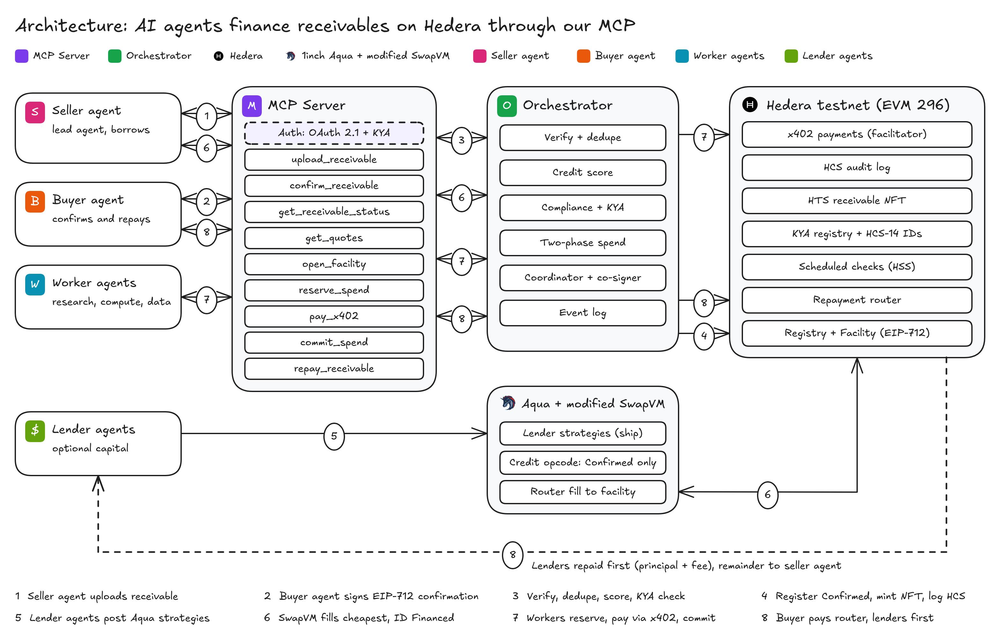

# CashETH

**Autonomous working capital for AI agents, on Hedera testnet.** A seller agent turns a receivable that a buyer agent has signed into USDC credit. Its worker agents spend that credit through x402, and when the buyer pays, lenders are repaid first, on-chain. Credit is funded by lenders' own wallets through a redeployed 1inch Aqua registry and a modified SwapVM router whose new opcode checks the receivable's on-chain state on every fill.

Built for ETHGlobal Mumbai. Targets: Hedera "AI Agents That Pay (x402)" and 1inch "Build an Aqua App".

Powered by Aqua — © Degensoft Ltd 2025



## Contents

1. [The eight-step flow](#1-the-eight-step-flow)
2. [Prize tracks](#2-prize-tracks)
3. [Deployed contracts (Hedera testnet, chain 296)](#3-deployed-contracts-hedera-testnet-chain-296)
4. [How it works](#4-how-it-works)
5. [The modified SwapVM](#5-the-modified-swapvm)
6. [Repository layout and how to run](#6-repository-layout-and-how-to-run)
7. [Evidence index](#7-evidence-index)
8. [Known limitations and rulings](#8-known-limitations-and-rulings)
9. [Next steps](#9-next-steps)
10. [Attribution and licenses](#10-attribution-and-licenses)

Related documents: [docs/EVIDENCE.md](docs/EVIDENCE.md) (every transaction), [docs/API.md](docs/API.md) (MCP tools and read API), [docs/DEMO_SCRIPT.md](docs/DEMO_SCRIPT.md), [BUILD.md](BUILD.md) (design spec), [LICENSE-THIRD-PARTY.md](LICENSE-THIRD-PARTY.md).

## 1. The eight-step flow

| # | Step | Who | What happens |
| --- | --- | --- | --- |
| 1 | Upload | seller agent | `upload_receivable` returns a pending id and an EIP-712 confirmation request for the buyer. |
| 2 | Confirm | buyer agent | Signs the `ReceivableConfirmation` (payee = `RepaymentRouter`) and calls `confirm_receivable`. |
| 3 | Verify | orchestrator | Checks signature, KYA levels and owner separation, dedupes the canonical id, computes the credit score and borrowing base. |
| 4 | Register | coordinator | `ReceivableRegistry.register` makes the state `Confirmed`. An HTS NFT is minted and the event goes to the HCS audit topic. |
| 5 | Ship | lender agents | Each lender has shipped Aqua strategies from its own wallet: a base-yield strategy and a credit strategy with a risk tier. |
| 6 | Fund | seller agent, coordinator | `open_facility` calls `CreditFacility.openAndFund`, which fills the cheapest eligible credit strategies through the modified router. The opcode checks `Confirmed` and the facility marks the id `Financed`, in one transaction. |
| 7 | Spend | worker agents | `reserve_spend`, then `pay_x402` from a 2-of-2 co-signed spend wallet, then `commit_spend`. |
| 8 | Repay | buyer agent | `repay_receivable`: `RepaymentRouter` pays lenders principal plus fee first and the seller the remainder. The id becomes `Repaid`. |

The demo also submits the same obligation twice (rejected with `DUPLICATE_RECEIVABLE`) and sends two spend requests that are rejected by policy. The demo script is [docs/DEMO_SCRIPT.md](docs/DEMO_SCRIPT.md).

## 2. Prize tracks

### Hedera: AI Agents That Pay (x402)

| Requirement | Status | Evidence |
| --- | --- | --- |
| Our own x402-protected endpoint | Done | `apps/merchant`: `GET /research?topic=...`, 0.25 USDC to merchant [0.0.11333304](https://hashscan.io/testnet/account/0.0.11333304); scheme `exact`, network `hedera:testnet`. Spike S3 in [EVIDENCE.md](docs/EVIDENCE.md). |
| Settles USDC on Hedera through a listed facilitator | Done | `https://x402.org/facilitator` settled the agent purchase [0.0.9185802@1793985365.210563681](https://hashscan.io/testnet/transaction/0.0.9185802@1793985365.210563681) (below), and earlier the spike payments [A](https://hashscan.io/testnet/transaction/0.0.9185802-1793964900-434830214) (single key) and [B](https://hashscan.io/testnet/transaction/0.0.9185802-1793964918-249682742) (2-of-2). |
| Agent pays with no human approval | Done | The research worker reserved, paid and committed with no human step: see "Settled x402 transaction" below. |
| Spending controls | Done in contracts and engine | Per-agent budget, per-transaction and daily limits, merchant allowlist, facility-wide ceiling, one open reservation per wallet, and a co-signer that must approve every payment. A single-signature payment from a 2-of-2 wallet was refused by the facilitator (S3). |
| Agent identity and reputation (HCS-14, ERC-8004-shaped) | Done | 10 HCS-14 UAIDs published on the audit topic ([EVIDENCE.md](docs/EVIDENCE.md), "C2: HCS topic, HCS-14 profiles"); `KYARegistry` holds KYA level, owner group and repayment counters. |
| HCS audit log | Done | Topic [0.0.11338927](https://hashscan.io/testnet/topic/0.0.11338927): agent profiles, `ReceivableConfirmed` seq 34, `NftMinted` seq 35. Hashes only. |
| Settling in an HTS token | Done | USDC [0.0.429274](https://hashscan.io/testnet/token/0.0.429274). |
| Scheduled Transactions (HIP-1215) | Done in the facility; see [section 4.6](#46-scheduled-lifecycle) | The funding transaction created exactly one schedule, `markOverdue` [0.0.11342318](https://hashscan.io/testnet/schedule/0.0.11342318) (pending until the due date + 7 days). Spike S4: network-executed schedule [0.0.11338268](https://hashscan.io/testnet/schedule/0.0.11338268) and deleted schedule [0.0.11338283](https://hashscan.io/testnet/schedule/0.0.11338283). |
| Hedera Agent Kit | Done | `agents/src/kit.ts` gives each agent a `hedera-agent-kit` 3.8.2 instance that runs the kit's `submit_topic_message_tool` (agent notes on an HCS topic) and `associate_token_tool` (HTS association) as the agent's own account. |

### 1inch: Build an Aqua App

| Requirement | Status | Evidence |
| --- | --- | --- |
| Redeploy Aqua on Hedera testnet | Done | Aqua registry [0xc65A…d54c](https://hashscan.io/testnet/contract/0xc65A0788a9AE598aEAB5DbC529B7649a1383d54c), deployed unmodified by us. |
| Modified SwapVM router (a redeployed, modified SwapVM is allowed by the track) | Done | `CashEthSwapVMRouter` [0x458b…ce1b](https://hashscan.io/testnet/contract/0x458b3b7CaDec64Cd0AE0B244d582006C4E99ce1b), custom opcode `ReceivableCredit` on `Opcode._21`, runtime 23,759 B. |
| Custom instruction gates fills on real state | Done | [Section 5](#5-the-modified-swapvm); `contracts/test/ReceivableCredit.t.sol`. |
| Lender strategies on-chain; token transfers visible on HashScan | Done | Strategies table in [section 4.2](#42-funding-through-aqua-shared-liquidity); spike S1 fill with HTS child transfer: [fill tx](https://hashscan.io/testnet/transaction/0.0.7314364@1793963078.419965153). |
| Shared liquidity | Done | One lender balance backs a base-yield strategy and a credit strategy. |
| Commits spread across the event | See `git log` | |
| Attribution | Done | [Section 10](#10-attribution-and-licenses). |

**Aqua funding transaction (`openAndFund` through the modified router, lenders A and B fill PO-1002, the receivable becomes Financed): [0.0.7314364@1793982496.157443985](https://hashscan.io/testnet/transaction/0.0.7314364@1793982496.157443985).**

**Settled Hedera x402 transaction: [0.0.9185802@1793985365.210563681](https://hashscan.io/testnet/transaction/0.0.9185802@1793985365.210563681).** The research worker's spend wallet [0.0.11339484](https://hashscan.io/testnet/account/0.0.11339484) (2-of-2: worker + co-signer) paid 0.25 USDC to merchant [0.0.11333304](https://hashscan.io/testnet/account/0.0.11333304) for `/research` on `hedera:testnet`, scheme `exact`, settled by `https://x402.org/facilitator` (fee payer 0.0.9185802). The id came back in the `PAYMENT-RESPONSE` header and was recorded on-chain at commit.

| Leg | Transaction |
| --- | --- |
| Reserve (facility funds the spend wallet) | [0.0.7314364@1793985356.566369946](https://hashscan.io/testnet/transaction/0.0.7314364@1793985356.566369946), HCS `SpendReserved` seq 44 |
| x402 settlement | [0.0.9185802@1793985365.210563681](https://hashscan.io/testnet/transaction/0.0.9185802@1793985365.210563681) |
| Commit (`keccak256` of the settlement id) | [0.0.7314364@1793985376.841020355](https://hashscan.io/testnet/transaction/0.0.7314364@1793985376.841020355), HCS `SpendCommitted` seq 45 |
| Rejection `TX_LIMIT_EXCEEDED` (0.6 USDC, `maxPerTx` 0.5), engine | HCS `SpendRejected` seq 46 |
| Rejection `AGENT_BUDGET_EXCEEDED` (5.5 USDC, budget 3.0), engine | HCS `SpendRejected` seq 47 |
| Same 5.5 USDC sent straight to `CreditFacility.reserve`: contract reverts `AGENT_BUDGET_EXCEEDED()` | [0.0.7314364@1793985589.809847638](https://hashscan.io/testnet/transaction/0.0.7314364@1793985589.809847638) |
| Unpaid reservation refused late (`RESERVATION_EXPIRED`), then released by the coordinator | [release 0.0.7314364@1793987537.265152144](https://hashscan.io/testnet/transaction/0.0.7314364@1793987537.265152144), HCS `SpendReleased` seq 53 |

Full detail and the mirror-node USDC movements: [docs/EVIDENCE.md](docs/EVIDENCE.md), "C5 spend (x402)", and `deployments/testnet/c5.json`.

## 3. Deployed contracts (Hedera testnet, chain 296)

Machine-readable record: [deployments/testnet/addresses.json](deployments/testnet/addresses.json). Per-contract transactions, gas and read-backs: `deployments/testnet/c2.json`, `c3.json`, `c4.json`.

The core stack was **redeployed on 2026-11-06** after a failed funding transaction (see the collapsed section below). Aqua, the order builder, tUSDT, the HCS topic, the NFT collection and the spend wallets were kept. Every address in the "kept" rows is the original deployment.

### Contracts

| Contract | Address (HashScan) | Contract id | Role | Status |
| --- | --- | --- | --- | --- |
| KYARegistry | [`0x81d1935e41705DCD4c4499285c74c955626673dD`](https://hashscan.io/testnet/contract/0x81d1935e41705DCD4c4499285c74c955626673dD) | 0.0.11341323 | Agent identity, KYA level, owner group, on-time and default counters (ERC-8004-shaped) | redeployed 2026-11-06 |
| ReceivableRegistry | [`0x0D118059D67cbe738aD86C4B8c25cdf06837791f`](https://hashscan.io/testnet/contract/0x0D118059D67cbe738aD86C4B8c25cdf06837791f) | 0.0.11341326 | Verifies the buyer's EIP-712 confirmation, canonical id, receivable state machine | redeployed 2026-11-06 |
| ReceivableCreditNote (RCN) | [`0x733bE9213C79Be5dC3E3dD68FB126182D2F74f15`](https://hashscan.io/testnet/contract/0x733bE9213C79Be5dC3E3dD68FB126182D2F74f15) | 0.0.11341528 | Note the facility sells to lenders for USDC in an Aqua fill | redeployed 2026-11-06 |
| CreditFacility | [`0x38ACd9F1FEED870b2507b1421bE887d9a751d9e0`](https://hashscan.io/testnet/contract/0x38ACd9F1FEED870b2507b1421bE887d9a751d9e0) | 0.0.11341529 | Funds a confirmed receivable through Aqua, budgets, spend reservations, HSS schedules | redeployed 2026-11-06 |
| RepaymentRouter | [`0x63B6f03a60026626B6052D800864dD74604f6a8a`](https://hashscan.io/testnet/contract/0x63B6f03a60026626B6052D800864dD74604f6a8a) | 0.0.11341530 | Payee of every confirmation; waterfall: lenders first, then the seller | redeployed 2026-11-06 |
| CashEthSwapVMRouter | [`0x458b3b7CaDec64Cd0AE0B244d582006C4E99ce1b`](https://hashscan.io/testnet/contract/0x458b3b7CaDec64Cd0AE0B244d582006C4E99ce1b) | 0.0.11341628 | Modified SwapVM router with the `ReceivableCredit` opcode | redeployed 2026-11-06 (facility address is an immutable) |
| CashEthTaker | [`0x8FC7B1BBa8EEdf5a4C9Ac9FEA746ABAd17804B5B`](https://hashscan.io/testnet/contract/0x8FC7B1BBa8EEdf5a4C9Ac9FEA746ABAd17804B5B) | 0.0.11341636 | Swap helper the scripted trader uses against the base-yield strategies | redeployed 2026-11-06 (router is an immutable) |
| Aqua registry (`AquaRouter`) | [`0xc65A0788a9AE598aEAB5DbC529B7649a1383d54c`](https://hashscan.io/testnet/contract/0xc65A0788a9AE598aEAB5DbC529B7649a1383d54c) | 0.0.11339989 | 1inch Aqua registry holding the strategies' virtual balances; unmodified | kept (block 42741303) |
| CashEthOrderBuilder | [`0x4125108453A1E9c333b100a917F630b84F3413Fb`](https://hashscan.io/testnet/contract/0x4125108453A1E9c333b100a917F630b84F3413Fb) | 0.0.11339998 | Builds orders and taker data on-chain for `eth_call` | kept |
| TestStablecoin (tUSDT, 6 dec.) | [`0x65C25Cc145f0836C8fFAb83Bf9676e98a8a2648a`](https://hashscan.io/testnet/contract/0x65C25Cc145f0836C8fFAb83Bf9676e98a8a2648a) | 0.0.11340006 | Second leg of the base-yield strategies | kept |

Deploy and wiring transactions of the current stack (all wiring is one-shot and read back from chain):

| Step | Transaction |
| --- | --- |
| KYARegistry deploy | [0.0.7314364@1793978954.588950176](https://hashscan.io/testnet/transaction/0.0.7314364@1793978954.588950176) |
| ReceivableRegistry deploy | [0.0.7314364@1793978957.638929669](https://hashscan.io/testnet/transaction/0.0.7314364@1793978957.638929669) |
| RCN deploy | [0.0.7314364@1793979983.761485389](https://hashscan.io/testnet/transaction/0.0.7314364@1793979983.761485389) |
| CreditFacility deploy | [0.0.7314364@1793979989.446409772](https://hashscan.io/testnet/transaction/0.0.7314364@1793979989.446409772) |
| RepaymentRouter deploy | [0.0.7314364@1793979992.300892540](https://hashscan.io/testnet/transaction/0.0.7314364@1793979992.300892540) |
| 20 HBAR into the facility (for HSS schedule fees) | [0.0.7314364@1793979998.723889452](https://hashscan.io/testnet/transaction/0.0.7314364@1793979998.723889452) |
| `ReceivableRegistry.wire(facility, repaymentRouter)` | [0.0.7314364@1793980017.168341300](https://hashscan.io/testnet/transaction/0.0.7314364@1793980017.168341300) |
| `KYARegistry.wire(repaymentRouter, facility)` | [0.0.7314364@1793980024.675648188](https://hashscan.io/testnet/transaction/0.0.7314364@1793980024.675648188) |
| CashEthSwapVMRouter deploy | [0.0.7314364@1793980328.280390902](https://hashscan.io/testnet/transaction/0.0.7314364@1793980328.280390902) |
| CashEthTaker deploy | [0.0.7314364@1793980360.664551738](https://hashscan.io/testnet/transaction/0.0.7314364@1793980360.664551738) |
| `ReceivableCreditNote.wire(facility, repaymentRouter, swapRouter, aqua)` | [0.0.7314364@1793980425.858553275](https://hashscan.io/testnet/transaction/0.0.7314364@1793980425.858553275) |
| `CreditFacility.wire(swapRouter, repaymentRouter)` | [0.0.7314364@1793980444.372359298](https://hashscan.io/testnet/transaction/0.0.7314364@1793980444.372359298) |

KYA registrations on the new registry (KYA issuer, one transaction each): [seller](https://hashscan.io/testnet/transaction/0.0.7314364@1793978969.206969469), [buyer](https://hashscan.io/testnet/transaction/0.0.7314364@1793979051.992267965), [workerResearch](https://hashscan.io/testnet/transaction/0.0.7314364@1793979068.059888846), [workerCompute](https://hashscan.io/testnet/transaction/0.0.7314364@1793979111.064268848), [lenderA](https://hashscan.io/testnet/transaction/0.0.7314364@1793979122.903942077), [lenderB](https://hashscan.io/testnet/transaction/0.0.7314364@1793979276.242368379), [lenderC](https://hashscan.io/testnet/transaction/0.0.7314364@1793979300.479479344), [lenderD](https://hashscan.io/testnet/transaction/0.0.7314364@1793980554.341621558).

### Infrastructure

| Item | Id | Notes |
| --- | --- | --- |
| USDC (HTS) | [0.0.429274](https://hashscan.io/testnet/token/0.0.429274) | 6 decimals; EVM facade `0x0000000000000000000000000000000000068cDa` |
| tUSDT | `0x65C2…648a` (above) | Plain ERC-20 we deployed; 50 minted to each lender, 20 to the trader (operator) account |
| HCS audit topic | [0.0.11338927](https://hashscan.io/testnet/topic/0.0.11338927) | `CashETH audit v1`; submit key = operator, no admin key; env `HCS_AUDIT_TOPIC_ID` |
| Receivable NFT collection | [0.0.11338934](https://hashscan.io/testnet/token/0.0.11338934) | `CashETH Receivable` / `CRCV`; env `RECEIVABLE_NFT_TOKEN_ID` |
| Operator (deployer, treasury) | [0.0.11333252](https://hashscan.io/testnet/account/0.0.11333252) | EVM `0x8Ac63d78d72Faa40B4fB04945Ea37124ee93E97e`; env `HEDERA_OPERATOR_ID` / `HEDERA_OPERATOR_KEY` |
| x402 merchant | [0.0.11333304](https://hashscan.io/testnet/account/0.0.11333304) | env `MERCHANT_ACCOUNT_ID` / `MERCHANT_KEY` |
| SPEND_WALLET_RESEARCH | [0.0.11339484](https://hashscan.io/testnet/account/0.0.11339484) | 2-of-2 key (workerResearch + cosigner); [create tx](https://hashscan.io/testnet/transaction/0.0.11333252@1793969914.172231452) |
| SPEND_WALLET_COMPUTE | [0.0.11339486](https://hashscan.io/testnet/account/0.0.11339486) | 2-of-2 key (workerCompute + cosigner); [create tx](https://hashscan.io/testnet/transaction/0.0.11333252@1793969922.674066550) |

Demo accounts, written by `pnpm setup:accounts` to `.env.accounts` as `<PREFIX>_ID`, `<PREFIX>_KEY`, `<PREFIX>_EVM` (names only here; keys are never committed):

| Role | Prefix | Account | KYA |
| --- | --- | --- | --- |
| seller | `SELLER` | [0.0.11337987](https://hashscan.io/testnet/account/0.0.11337987) | role 1, level 2 |
| buyer | `BUYER` | [0.0.11337988](https://hashscan.io/testnet/account/0.0.11337988) | role 2, level 3 |
| research worker | `WORKER_RESEARCH` | [0.0.11337989](https://hashscan.io/testnet/account/0.0.11337989) | role 3, level 2 |
| compute worker | `WORKER_COMPUTE` | [0.0.11337990](https://hashscan.io/testnet/account/0.0.11337990) | role 3, level 2 |
| lender A | `LENDER_A` | [0.0.11337991](https://hashscan.io/testnet/account/0.0.11337991) | role 4, level 2 |
| lender B | `LENDER_B` | [0.0.11337992](https://hashscan.io/testnet/account/0.0.11337992) | role 4, level 2 |
| lender C | `LENDER_C` | [0.0.11337993](https://hashscan.io/testnet/account/0.0.11337993) | role 4, level 2 |
| lender D | `LENDER_D` | [0.0.11340117](https://hashscan.io/testnet/account/0.0.11340117) | role 4, level 2 |
| coordinator (submits `openAndFund`, `reserve`) | `COORDINATOR` | [0.0.11337994](https://hashscan.io/testnet/account/0.0.11337994) | n/a |
| policy co-signer | `COSIGNER` | [0.0.11337995](https://hashscan.io/testnet/account/0.0.11337995) | n/a |
| KYA issuer | `KYA_ISSUER` | [0.0.11337996](https://hashscan.io/testnet/account/0.0.11337996) | n/a |

<details>
<summary>Archived first deployment, and why it was replaced</summary>

The first core deployment (record: `deployments/testnet/archive-2026-11-06-redeploy.json`) worked through registration and strategy shipping. The first Aqua-funded `openAndFund` then failed: the facility made two Hedera Schedule Service `scheduleCall`s in one transaction (`markOverdue` and `markDefaulted`), and Hedera's recursion protection (HIP-1215) allows one per transaction. The network rejected it with `NO_SCHEDULING_ALLOWED_AFTER_SCHEDULED_RECURSION` ([failed transaction](https://hashscan.io/testnet/transaction/0.0.7314364@1793976431.091663990)).

The fix (commit `b2a4ab1`): funding schedules only `markOverdue`, which schedules `markDefaulted` when it runs. The facility address is an immutable in the SwapVM router, the repayment router and the taker, and every `wire()` is one-shot, so the core stack was redeployed. The old strategies were docked and the lenders' Aqua allowances cleared (docks and allowance clears are listed in the archive file).

| Contract | First deployment (archived, not used) |
| --- | --- |
| KYARegistry | [`0xE51950be227c5A31B603e1343cD53e813C593f39`](https://hashscan.io/testnet/contract/0xE51950be227c5A31B603e1343cD53e813C593f39) |
| ReceivableRegistry | [`0x112167Ad230f4b733B756201FDe8b4ec3BC97A8b`](https://hashscan.io/testnet/contract/0x112167Ad230f4b733B756201FDe8b4ec3BC97A8b) |
| ReceivableCreditNote | [`0x54a665d52E2e79bA3Ec46b20f8c2cfE950C9A0ce`](https://hashscan.io/testnet/contract/0x54a665d52E2e79bA3Ec46b20f8c2cfE950C9A0ce) |
| CreditFacility | [`0xfe702433E753ca4CA8dEDC3059987eCA7B8fe640`](https://hashscan.io/testnet/contract/0xfe702433E753ca4CA8dEDC3059987eCA7B8fe640) |
| RepaymentRouter | [`0xcf6DeBDfc01a9DcafDBf0Ad45f4ebc185dB705f7`](https://hashscan.io/testnet/contract/0xcf6DeBDfc01a9DcafDBf0Ad45f4ebc185dB705f7) |
| CashEthSwapVMRouter | [`0xFcE311Ea7f4B4F8D5d897d48BFA2a21DcC34A562`](https://hashscan.io/testnet/contract/0xFcE311Ea7f4B4F8D5d897d48BFA2a21DcC34A562) |
| CashEthTaker | [`0x506646D702C00A19854eE1f28eF3F396E32a3838`](https://hashscan.io/testnet/contract/0x506646D702C00A19854eE1f28eF3F396E32a3838) |

The C2, C3 and C4 sections of [docs/EVIDENCE.md](docs/EVIDENCE.md) record this first deployment (its registration of PO-1002, the duplicate rejection, wiring, sizes and the invariant suite). The spike sections (S1 to S4) are independent of it.

</details>

## 4. How it works

### 4.1 Receivables

- The buyer agent signs an EIP-712 `ReceivableConfirmation` (domain `AgentReceivables` v1, chain 296, verifying contract = `ReceivableRegistry`): seller, buyer, currency, amount, due date, `buyerRef`, `detailsCommitment`, `payTo`, nonce, deadline. The canonical id is `keccak256(abi.encode(buyer, buyerRef))`, so the same obligation always maps to the same id.
- `ReceivableRegistry.register` checks, in order: duplicate (`DUPLICATE_RECEIVABLE`), buyer signature (`BAD_BUYER_SIG`), payee equals `RepaymentRouter` (`WRONG_PAYEE`), deadline and a 1 to 120 day term, nonce, currency, KYA levels (buyer at least 3, seller at least 2, unrevoked and unexpired), and different owner groups (`SELF_DEALING`).
- Only hashes go on-chain and to HCS: `detailsCommitment` is the keccak256 of the invoice file (section 4.7), never the contents.
- The HTS NFT is a handle for the receivable, not the source of truth: its metadata is `{id, seq}` where `seq` is the HCS sequence of `ReceivableConfirmed`.

Current-stack evidence for PO-1002 (6 USDC, due in 30 days, id `0xb1a0a92a58af18bbeb4bad3485f23aeb7f6987d15c271513a5d5b6072bee844c`):

| Item | Transaction |
| --- | --- |
| `register` (state `Confirmed`) | [0.0.7314364@1793980592.500689981](https://hashscan.io/testnet/transaction/0.0.7314364@1793980592.500689981) |
| HCS `ReceivableConfirmed`, seq 34 | [0.0.11333252@1793980598.332603471](https://hashscan.io/testnet/transaction/0.0.11333252@1793980598.332603471) |
| NFT serial 2 minted | [0.0.11333252@1793980599.981683574](https://hashscan.io/testnet/transaction/0.0.11333252@1793980599.981683574) |
| HCS `NftMinted`, seq 35 | [0.0.11333252@1793980602.620678492](https://hashscan.io/testnet/transaction/0.0.11333252@1793980602.620678492) |
| Same obligation again: reverts `DUPLICATE_RECEIVABLE()` (`0x55e1137b`) | [0.0.7314364@1793980736.789329045](https://hashscan.io/testnet/transaction/0.0.7314364@1793980736.789329045) |

Earlier rejections on the first deployment, kept as evidence of the checks (the registry code is unchanged): [`WRONG_PAYEE()`](https://hashscan.io/testnet/transaction/0.0.7314364@1793966502.770050429) and [`BAD_BUYER_SIG()`](https://hashscan.io/testnet/transaction/0.0.7314364@1793966532.109597123).

**Credit score** (`packages/engine/src/score.ts`, deterministic; AI explains a decision through `explain_decision` but never makes one):

| Rule | Value |
| --- | --- |
| Base score | 600 |
| Buyer on-time repayments | +15 each, capped at 10 |
| Late repayment | -40 each |
| Default | -200 each |
| Tenor longer than 60 days | -50 |
| Advance rate | 80% at score 700 or more, 75% at 600 or more, 60% at 500 or more, declined below 500 |
| Approval | buyer KYA level 3 and seller KYA level 2 |
| Limit | at most 1,000 USDC for a level 2 seller, 10,000 USDC for level 3 |

The on-chain on-time and default counters in `KYARegistry` feed the score. Lenders additionally enforce seller thresholds in the opcode at fill time (below), so the score is the facility's view and the tier is each lender's own.

### 4.2 Funding through Aqua (shared liquidity)

There is no pool contract and no external yield protocol. A lender's USDC stays in the lender's own wallet. One lender balance backs two Aqua strategies on `CashEthSwapVMRouter` ("shared liquidity"):

| Strategy | Program | Purpose |
| --- | --- | --- |
| Base yield | `Salt`, `FeeFlatIn`, `XYCSwap`: constant product over USDC / tUSDT with a 30 bps fee | Earns swap fees. Variable. |
| Credit (boost) | `Salt`, `ReceivableCredit(args)` over USDC / RCN | Sells USDC 1:1 for RCN against a confirmed receivable at the lender's fixed `aprBps`. |

The base APR is measured from real on-chain swaps by a scripted trader agent (through `CashEthTaker`) and is labelled "scripted volume" wherever shown; it is not a promised rate. The credit APR is the fixed leg. Per-lender `baseApr`, `boostApr` and `blendedApr` are computed by the MCP server (`apps/mcp-server/src/orchestrator/stats.ts`) from the Aqua and router logs and served by `GET /lenders`.

**Risk tiers** are presets of the opcode's arguments, enforced on-chain at fill time:

| Tier | aprBps | minSellerOnTime | maxSellerDefaults | minBuyerOnTime | maxPerBuyer | sellerSet |
| --- | --- | --- | --- | --- | --- | --- |
| low | 700 | 3 | 0 | 0 | 5 USDC | optional allowlist |
| medium | 850 | 1 | 0 | 0 | 5 USDC | optional allowlist |
| high | 1300 | 0 | 2 | 0 | 5 USDC | empty (any seller) |

A non-empty `sellerSet` (up to 3 addresses) replaces the score thresholds: an explicit choice beats the score.

**Current strategies** (shipped to the kept Aqua registry with the new router as app; sized to the lenders' real balances; record: [deployments/testnet/strategies.json](deployments/testnet/strategies.json)):

| Lender | Tier | Credit | Base | sellerSet | Result for PO-1002 (observed) |
| --- | --- | --- | --- | --- | --- |
| A | low (700 bps) | 3.5 USDC | 0.5 USDC + 0.5 tUSDT | seller | filled 3.5 USDC |
| B | medium (850 bps) | 1.5 USDC | 0.5 USDC + 0.5 tUSDT | seller | filled 1.0 USDC (the remainder) |
| C | high (1300 bps) | 0.5 USDC | 0.5 USDC + 0.5 tUSDT | any | `NOT_NEEDED` (eligible, most expensive) |
| D | low (700 bps) | 1.0 USDC | none | workerResearch | skipped on-chain: `SELLER_NOT_FUNDED_BY_LENDER` |

PO-1002 is 6 USDC with a 75% advance, so the borrowing base is 4.5 USDC. The last column is what the solver and the chain did in the `openAndFund` transaction [0.0.7314364@1793982496.157443985](https://hashscan.io/testnet/transaction/0.0.7314364@1793982496.157443985) (A 3.5 USDC, B 1.0 USDC, C not needed, D skipped).

`Aqua.ship` transactions (from `strategies.json`; strategy hashes are in [docs/EVIDENCE.md](docs/EVIDENCE.md), "C4 strategies (final)"):

| Lender | Kind | Transaction |
| --- | --- | --- |
| A | credit, 3.5 USDC | [0.0.7314364@1793980834.590739155](https://hashscan.io/testnet/transaction/0.0.7314364@1793980834.590739155) |
| A | base, 0.5 + 0.5 | [0.0.7314364@1793980911.340291226](https://hashscan.io/testnet/transaction/0.0.7314364@1793980911.340291226) |
| B | credit, 1.5 USDC | [0.0.7314364@1793981034.732736160](https://hashscan.io/testnet/transaction/0.0.7314364@1793981034.732736160) |
| B | base, 0.5 + 0.5 | [0.0.7314364@1793981428.956894431](https://hashscan.io/testnet/transaction/0.0.7314364@1793981428.956894431) |
| C | credit, 0.5 USDC | [0.0.7314364@1793981544.024005875](https://hashscan.io/testnet/transaction/0.0.7314364@1793981544.024005875) |
| C | base, 0.5 + 0.5 | [0.0.7314364@1793981618.317305300](https://hashscan.io/testnet/transaction/0.0.7314364@1793981618.317305300) |
| D | credit, 1.0 USDC | [0.0.7314364@1793982142.770577875](https://hashscan.io/testnet/transaction/0.0.7314364@1793982142.770577875) |

**Funding result** (`deployments/testnet/facility.json`; score 600, advance 75%, limit 4.5 USDC): `openAndFund` [0.0.7314364@1793982496.157443985](https://hashscan.io/testnet/transaction/0.0.7314364@1793982496.157443985) filled A 3.5 USDC at 700 bps and B 1.0 USDC at 850 bps, so the facility holds 4.5 USDC and A and B hold 3.5 and 1.0 RCN. The receivable is `Financed` and HCS `FacilityFunded` is seq 36 ([tx](https://hashscan.io/testnet/transaction/0.0.11333252@1793982667.668877640)). C was skipped as `NOT_NEEDED` and D as `SELLER_NOT_FUNDED_BY_LENDER`. Two real reverts prove the access checks: `NOT_CONFIRMED()` for an unregistered id ([tx](https://hashscan.io/testnet/transaction/0.0.7314364@1793982511.134508238)) and `NOT_COORDINATOR()` when the seller calls it ([tx](https://hashscan.io/testnet/transaction/0.0.7314364@1793982519.722396023)).

**Measured base yield ("scripted volume").** The trader agent made 4 real swaps against lender A's base strategy (two USDC to tUSDT and back round trips of 0.2 USDC, through `CashEthTaker`; record `deployments/testnet/trades.json`, links in [docs/EVIDENCE.md](docs/EVIDENCE.md), "C4 base yield (scripted volume)"). Fees are 30 bps of the 0.684925 USDC-equivalent pushed in: 0.002054 USDC.

| Lender | Capital (USDC) | Lent | Base fees | Base APR | Boost APR | Blended APR |
| --- | ---: | ---: | ---: | ---: | ---: | ---: |
| A (low) | 4.01081 | 3.5 | 0.002054 | 2820.05% | 7% | 365.27% |
| B (medium) | 2 | 1 | 0 | 0% | 8.5% | 4.25% |
| C (high) | 1 | 0 | 0 | 0% | 13% | 0% |
| D (low) | 1 | 0 | 0 | 0% | 7% | 0% |

Read this with care: only lender A was traded (B and C were not, for time, because the relay took 1 to 5 minutes per transaction), so their base APR of 0 is not a result. A's base APR is a measurement over about 38 minutes on a 1.0 virtual balance, annualised; it shows the mechanism works on real swaps and is not a forecast or a guaranteed rate. Price impact is large because the pool is small.

**Solver** (`packages/aqua/src/solver.ts`, off-chain, deterministic): discover open strategies from `Shipped` events, quote each credit strategy through `router.quote` called as the facility (so the tier, seller set and per-buyer cap decide eligibility on-chain), sort by `aprBps` ascending, and fill until the borrowing base is reached. `CreditFacility.openAndFund` re-checks that the fills are cheapest-first (`NOT_CHEAPEST_FIRST`) and within the borrowing base (`BORROWING_BASE_EXCEEDED`), so the coordinator cannot overpay a lender.

### 4.3 Spending through x402

Hedera's `exact` scheme has the client sign a `TransferTransaction` that debits its own account, and the facilitator pays the fee. A contract cannot sign that, so the facility cannot be the payer. CashETH uses **2-of-2 co-signed spend wallets**:

- Each worker has an account with key `KeyList([worker, cosigner], threshold 2)`, associated with USDC, holding no balance between payments.
- `reserve_spend`: the engine checks policy, then the coordinator calls `CreditFacility.reserve`, which moves exactly the reserved USDC into the wallet. The same checks run again in the contract.
- `pay_x402`: the worker calls the merchant, gets `402` with `PaymentRequirements` and signs the transfer. The co-signer signs only if scheme, network, asset, `payTo`, amount and payer match the open reservation **and** the transaction bytes move exactly that USDC and nothing else. Facilitator: `https://x402.org/facilitator`. The settlement transaction id is in the `PAYMENT-RESPONSE` header.
- `commit_spend` records the Hedera transaction id on-chain and posts `SpendCommitted` to HCS. An expired, unpaid reservation is released with `release_spend` (the coordinator pulls the USDC back through the facility's allowance); the co-signer signs at most one payment per reservation.

| Policy | Error codes (same names in engine, contracts and MCP) |
| --- | --- |
| Budgets and limits | `AGENT_BUDGET_EXCEEDED`, `TX_LIMIT_EXCEEDED`, `DAILY_LIMIT_EXCEEDED`, `GLOBAL_CREDIT_LIMIT_EXCEEDED` |
| Merchant | `MERCHANT_NOT_ALLOWED` |
| Wallet and reservation | `WALLET_BUSY`, `RESERVATION_EXISTS`, `RESERVATION_EXPIRED`, `RESERVATION_NOT_OPEN`, `SPEND_WALLET_NOT_REGISTERED` |
| Lifecycle | `FACILITY_NOT_ACTIVE`, `PAUSED`, `NOT_FINANCED` |
| Lender rules in the opcode | `SELLER_NOT_FUNDED_BY_LENDER`, `LENDER_RESERVE_TOO_LOW` |
| Receivable | `DUPLICATE_RECEIVABLE`, `BAD_BUYER_SIG`, `WRONG_PAYEE`, `BAD_NONCE`, `TERM_INELIGIBLE`, `KYA_FAIL`, `SELF_DEALING`, `NOT_CONFIRMED` |

The workers can also be run as LLM agents (a local Ollama model by default, Claude optionally) that choose and buy the service themselves under a client-side spend cap: see [docs/LLM_AGENTS.md](docs/LLM_AGENTS.md).

Spike S3 proved the mechanism before the agents were integrated: [payment A](https://hashscan.io/testnet/transaction/0.0.9185802-1793964900-434830214) (single key) and [payment B](https://hashscan.io/testnet/transaction/0.0.9185802-1793964918-249682742) (2-of-2 key, worker plus co-signer), each 0.25 USDC to the merchant. The same wallet paying with the worker signature alone was refused by the facilitator with HTTP 402 `invalid_exact_hedera_payload_signature_invalid`, and its USDC did not move.

### 4.4 Repayment waterfall

```
fee_i     = principal_i * aprBps_i * max(elapsed, 30 days) / (365 days * 10_000)    (floored)
lenderDue = sum(principal_i + fee_i)
payment   -> lenders pro rata until lenderDue is paid -> seller agent gets the remainder
undrawn USDC left in the facility goes to the seller agent when the facility closes
```

`RepaymentRouter` is the payee of every confirmation, so the buyer's payment cannot reach the seller before lenders are paid. Repayment always works, including when overdue. Invariants (fuzz and invariant suite, recorded in EVIDENCE.md at C3 with 128 runs x depth 32): budgets never exceed funded, committed + reserved + available equals funded, debt never exceeds the borrowing base, the seller gets nothing while lenders are owed, state only moves forward.

### 4.5 Identity

Every agent has an ECDSA key, a Hedera account, an HCS-14 UAID (published as `AgentRegistered` on the audit topic) and a `KYARegistry` entry (role, level, owner group, mandate hash). The MCP server is an OAuth 2.1 resource server: an agent proves itself to `apps/auth-server` with an ES256K-signed JWT (RFC 7523), the authorization server checks the registry, and issues a short-lived, audience-bound token whose scopes depend on role and level. Tokens are never passed through to other services. The assertion's UAID must be the one the registry holds for the agent's address. Details and all 20 tools: [docs/API.md](docs/API.md).

Configuration: the authorization and MCP servers bind to `HOST` (default `127.0.0.1`). `AUTH_DEMO_GRANT=true` adds a demo authorization-code + PKCE grant for human MCP clients such as Claude Code ([docs/CLAUDE_CODE_DEMO.md](docs/CLAUDE_CODE_DEMO.md)): a consent page where you pick a demo role (seller, buyer, worker, lender) and get that agent's scopes, never `agent:admin`. The demo grant exists for the judges' walkthrough and has no owner login, so anyone who reaches the page can act as any demo agent: it is off by default and must never be enabled on a public host. `agent:admin` (`register_agent`) is only granted through JWT-bearer to the configured KYA issuer (`KYA_ISSUER_EVM`).

### 4.6 Scheduled lifecycle

The facility schedules its own overdue and default checks through the Hedera Schedule Service (HIP-1215, system contract `0x16b`), so no keeper bot is needed. **Hedera allows one `scheduleCall` per transaction.** `openAndFund` therefore schedules only `markOverdue` (7 days after the due date); `markOverdue` schedules `markDefaulted` (30 days after the due date) when it runs. Both are also callable by anyone once due. Repayment always pays lenders first.

HSS mechanism evidence (spike S4): schedule [0.0.11338268](https://hashscan.io/testnet/schedule/0.0.11338268) was executed by the network about 46 ms after its expiry second with the contract as `msg.sender`; schedule [0.0.11338283](https://hashscan.io/testnet/schedule/0.0.11338283) was deleted before it fired. The two-schedules-in-one-transaction failure that led to the fix is linked in [section 3](#3-deployed-contracts-hedera-testnet-chain-296).

### 4.7 Invoice documents

The seller can attach the real invoice. `upload_invoice_document` stores the PDF (or text) file, reads its printed fields (amount, currency, due date, buyer reference) with a local model or a heuristic fallback, and returns its keccak256. That hash is used as the receivable's `detailsCommitment`, so the buyer's EIP-712 signature covers the exact file. `confirm_receivable` rejects a document whose printed terms differ from the submitted ones (`INVOICE_MISMATCH`).

Anyone can check it without trusting us: `GET /invoices/:keccak256` returns the stored bytes, and `scripts/c9-invoice-verify.ts <receivableId>` hashes them and compares with `ReceivableRegistry.get(id).detailsCommitment`, printing `VERIFIED` or `MISMATCH`. Details: [docs/API.md](docs/API.md).

Registered from an invoice PDF (PO-1003): [0.0.7314364@1793989261.174955397](https://hashscan.io/testnet/transaction/0.0.7314364@1793989261.174955397), receivable `0xc7fd228d5a20c42b8ac4083d9c8d073ef84bb76905ce5b5f8acdf279ca42dc8b`; the stored document verifies against the on-chain commitment.

### 4.8 Agent modes

| Mode | What drives the tools | Doc |
| --- | --- | --- |
| Scripted agents | `agents/` seller, buyer, worker, lender, trader and the demo runner (`pnpm demo`) | [docs/DEMO_SCRIPT.md](docs/DEMO_SCRIPT.md) |
| LLM agents | A language model chooses the MCP tools; an agent wrapper enforces a client-side spend cap. Local Ollama by default (no API key), Claude optional. | [docs/LLM_AGENTS.md](docs/LLM_AGENTS.md) |
| Claude Code as a client | Claude Code connects as a remote MCP client (`.mcp.json`, OAuth with PKCE through the demo grant) and buys the research report as the research worker | [docs/CLAUDE_CODE_DEMO.md](docs/CLAUDE_CODE_DEMO.md) |

All three use the same 20 MCP tools and the same on-chain checks. The model never approves credit: the score is deterministic and `explain_decision` only explains it.

### 4.9 Security hardening from the final review

| Change | Effect |
| --- | --- |
| Demo authorization-code grant off by default (`AUTH_DEMO_GRANT=true` to enable); servers bind `127.0.0.1` | No open path to act as an agent; `agent:admin` is never granted from a query flag, only to the KYA issuer through JWT-bearer |
| UAID bound to the registry | The assertion's UAID must match the registry's hash for that address, so audit identity and evidence binding cannot be spoofed |
| Single payment per reservation | The co-signer records that it signed for a `spendId` and refuses a second payment; a retry cannot pay twice |
| `release_spend` tool, commit after expiry | An unpaid or expired reservation is released by the coordinator; a paid one can still be committed, so a wallet cannot stay busy |
| No repay after `Repaid`; deterministic idempotency keys for repay and ship | A retried repayment cannot send a second payment to the seller; a retried ship cannot duplicate a strategy |
| Strategies with hook or Permit2 flags are skipped | A foreign strategy cannot pass the solver's dry run and then fail the real fill |
| Document checks run however the commitment is given | A `detailsCommitment` that equals a stored document's hash gets the same printed-terms checks as naming the document |

## 5. The modified SwapVM

`CashEthSwapVMRouter is Simulator, SwapVM, AquaOpcodes`: the same base and constructor arguments as 1inch's `AquaSwapVMRouter`, with one added instruction.

| Item | Value |
| --- | --- |
| Source | [contracts/src/aqua/CashEthSwapVMRouter.sol](contracts/src/aqua/CashEthSwapVMRouter.sol), [contracts/src/aqua/ReceivableCredit.sol](contracts/src/aqua/ReceivableCredit.sol), [contracts/src/aqua/CashEthOrderBuilder.sol](contracts/src/aqua/CashEthOrderBuilder.sol) |
| Custom opcode | `ReceivableCredit` on the free slot `Opcode._21` of the conditions bank |
| Dropped to fit EIP-170 | `XYCConcentrateSwap`. With it the runtime is 24,650 B (74 over the limit); without it 23,759 B. A program using it reverts `UnknownOpcode`. CashETH ships no concentrated strategies. |
| Runtime size | 23,759 B, initcode 25,445 B, margin 817 B |
| Added immutables | `REGISTRY`, `KYA`, `FACILITY` |
| Added view | `exposure(maker, buyer)`: cumulative USDC a lender has advanced against a buyer (`maxPerBuyer` applies to it; repayments do not reduce it) |
| EIP-712 domain | "CashETH SwapVM", "1.0.0", chain 296 |
| Order and taker bytes | Built on-chain by `CashEthOrderBuilder` through `eth_call`; nothing is hand-encoded off-chain |
| Code check | In the first deployment the deployed runtime of each contract was read from the mirror node and matched `out/` byte for byte (immutables masked) |

```
cd contracts && forge build --sizes | grep CashEthSwapVMRouter
| CashEthSwapVMRouter | 23,759 | 25,445 | 817 | 23,707 |
```

**What the opcode enforces on every fill** (first failure reverts the swap; see the header of `ReceivableCredit.sol`):

1. `taker == facility`. Only the credit facility can fill a credit strategy.
2. Taker args are exactly `[bytes32 id, uint16 advanceBps]`.
3. `registry.get(id).state == Confirmed`: no confirmed receivable, no fill.
4. Seller filter: a non-empty `sellerSet` must contain the seller; otherwise the seller's KYA reputation must meet `minSellerOnTime` and `maxSellerDefaults`. Failure: `SELLER_NOT_FUNDED_BY_LENDER`.
5. Remaining tenor is positive and at most `maxTenorDays`.
6. `advanceBps <= maxAdvanceBps`.
7. Buyer reputation `onTime >= minBuyerOnTime`.
8. Output token is the receivable's currency; direction is RCN to USDC.
9. The amount fits the strategy's Aqua balance and the lender's per-buyer exposure cap, and leaves at least `minReserve` USDC in the lender's wallet. Failure: `LENDER_RESERVE_TOO_LOW`.

Pricing is 1:1; the lender's yield is the `aprBps` in its strategy. On a real swap the opcode adds to `exposure[maker][buyer]` and calls `facility.onCreditFill(id, maker, amount, aprBps)`. The default 1inch taker gate (a KYC NFT balance check) is not used; the opcode restricts the taker to the facility instead.

Tests: `contracts/test/` (`ReceivableCredit.t.sol`, `CashEthSwapVMRouter.t.sol`, `CashEthTaker.t.sol`, `invariants/`), and anvil-backed TypeScript tests in `packages/aqua`.

Spike S1 evidence that Aqua and SwapVM run on Hedera with real HTS USDC: [ship](https://hashscan.io/testnet/transaction/0.0.7314364@1793963071.121512471), [fill](https://hashscan.io/testnet/transaction/0.0.7314364@1793963078.419965153) (the HTS child transfer debits the lender's allowance with `is_approval: true`).

**License.** Powered by Aqua — © Degensoft Ltd 2025. The router source is published under `LicenseRef-Degensoft-SwapVM-1.1` terms with changes marked and dated 2026-11-06. The Aqua registry is `LicenseRef-Degensoft-Aqua-Source-1.1` (source-available), redeployed unmodified on testnet. See [LICENSE-THIRD-PARTY.md](LICENSE-THIRD-PARTY.md).

## 6. Repository layout and how to run

| Path | Contents |
| --- | --- |
| `contracts/` | Foundry project. `src/core` (registries, RCN, facility, repayment router, taker, tUSDT), `src/aqua` (router, opcode, order builder), `src/hedera` (HTS, HSS interfaces), `test/`, `script/` (deploy scripts), `lib/` (submodules) |
| `packages/shared` | `@casheth/shared`: env, addresses, ABIs, EIP-712 types, error codes, HashScan helpers |
| `packages/hedera` | `@casheth/hedera`: viem and Hiero SDK helpers, HCS, NFT, HCS-14, spend wallets, x402 client signer |
| `packages/aqua` | `@casheth/aqua`: order builder calls, ship and dock, strategy discovery, solver |
| `packages/engine` | `@casheth/engine`: credit score, borrowing base, spend policy, co-signer policy, event store, idempotency |
| `apps/merchant` | Our x402 research API |
| `apps/auth-server` | OAuth 2.1 authorization server with KYA checks |
| `apps/mcp-server` | MCP tools (20), orchestrator, read API (`/events`, `/agents`, `/lenders`, `/receivables/:id`) |
| `agents/` | `AgentClient` and the seller, buyer, worker, lender and trader agents; Hedera Agent Kit wrapper; demo runner |
| `scripts/` | Account setup, deploy and wiring drivers (`c2` to `c5`), spikes, sweep, ABI sync |
| `deployments/testnet/` | Addresses and run records |
| `docs/` | `EVIDENCE.md`, `API.md`, `DEMO_SCRIPT.md`, `LLM_AGENTS.md`, `CLAUDE_CODE_DEMO.md` |
| `diagrams/` | Architecture diagram |

### Prerequisites

- Node 22 (`.nvmrc`) and pnpm 11.
- **Foundry**, installed or updated with `foundryup`. On some machines the `forge` on `PATH` is a different CLI (for example an Atlassian tool). Check that `forge --version` prints Foundry; otherwise point the scripts at the real binary with `FORGE=/path/to/foundry/forge`, and the anvil-backed tests at its directory with `FOUNDRY_BIN=$HOME/.foundry/bin`.
- A funded Hedera testnet ECDSA operator account (HBAR, and USDC from `https://faucet.circle.com`, Hedera Testnet).

### Setup

```
git clone --recurse-submodules <repo>        # contracts/lib/{forge-std,openzeppelin-contracts,solidity-utils,aqua,swap-vm}
cp .env.example .env                         # operator, merchant, JSON-RPC relay, USDC ids, x402 facilitator, ports
pnpm install
pnpm -r build
pnpm setup:accounts                          # creates the demo accounts, writes .env.accounts, funds them
(cd contracts && forge build && forge test)
pnpm abi:sync
```

`.env` holds operator and service settings; `.env.accounts` holds the demo account ids and keys (`<PREFIX>_ID/_KEY/_EVM`). Neither is committed. Do not duplicate the demo accounts in `.env`: it takes precedence.

### Tests

```
pnpm test                                    # all TypeScript packages (vitest)
pnpm lint                                    # tsc --noEmit in every package
(cd contracts && forge test)                 # unit, fuzz and invariant tests
FOUNDRY_BIN=$HOME/.foundry/bin pnpm -F @casheth/aqua test    # anvil-backed Aqua tests (starts anvil)
```

Live tests that touch testnet are opt-in (for example `LIVE=1 pnpm -F @casheth/aqua exec vitest run --project unit discover.live`).

### Deploy (already done; scripts are re-runnable)

Deploys go through the Hashio relay. Each driver runs `forge script` with `--legacy --slow --skip-simulation` (forge's replay cannot execute the HTS and HSS system contracts), then does wiring and read-backs in TypeScript:

```
FORGE=/path/to/forge pnpm tsx scripts/c2-register-demo.ts      # KYARegistry, ReceivableRegistry, agent registrations
pnpm tsx scripts/c2-topic-and-nft.ts                           # HCS topic, NFT collection, HCS-14 profiles
FORGE=/path/to/forge pnpm tsx scripts/c3-deploy.ts             # RCN, CreditFacility, RepaymentRouter
pnpm tsx scripts/c5-spend-wallets.ts                           # 2-of-2 spend wallets
FORGE=/path/to/forge pnpm tsx scripts/c4-deploy-and-wire.ts    # Aqua, router, order builder, tUSDT, taker, wiring
pnpm tsx scripts/c4-register.ts                                # first registration and the duplicate rejection
```

Hedera notes: HTS `approve(spender, type(uint256).max)` reverts (allowances are int64), so USDC approvals are exact amounts. A constructor that calls `associate()` costs about 1.0M gas. Contracts that hold HBAR are funded through `receive()` in a second transaction. One `scheduleCall` per transaction. Details are in [docs/EVIDENCE.md](docs/EVIDENCE.md).

### Servers and the demo

```
pnpm -F @casheth/merchant start              # x402 merchant, MERCHANT_PORT (default 3003)
pnpm -F @casheth/auth start                  # authorization server, AUTH_PORT (default 4020)
pnpm -F @casheth/mcp start                   # MCP server and read API, MCP_PORT (default 4030)
pnpm demo                                    # drives the eight steps, the duplicate and two rejections
```

`pnpm demo` (root script; walkthrough in `docs/DEMO.md` on the demo branch) starts and stops the servers itself (or expects them with `DEMO_SERVERS=external`), drives the eight steps plus the duplicate and the two rejections through the MCP tools, prints a HashScan link for each step, appends the run to [docs/EVIDENCE.md](docs/EVIDENCE.md) under a dated "Demo run" heading, and exits non-zero if a step has no Hedera transaction id. For a demo run the MCP server may sign for the demo agents (`AGENT_KEYS_IN_PROCESS=true`, `LENDER_KEYS_IN_PROCESS=true`); in normal operation agents sign their own transactions and the server returns calldata.

The agent-driven run on PO-1003 (registered from the invoice PDF, section 4.7) is being recorded: its funding and repayment transaction ids are appended by the demo runner to the "Demo run" section of EVIDENCE.md. The funding, x402 and spend evidence above comes from the PO-1002 run.

### Frontend

The UI is a separate Next.js app on the branch `feat/nextjs-frontend` (`frontend/`: landing and docs pages). It is integrated last and consumes the read API: `GET /events`, `/agents`, `/lenders`, `/receivables/:id` (types in [docs/API.md](docs/API.md)). The MCP server allows the frontend's origin through `CORS_ORIGINS`.

## 7. Evidence index

Everything is recorded in [docs/EVIDENCE.md](docs/EVIDENCE.md) and the run records under `deployments/testnet/`. Headline links:

| What | Where |
| --- | --- |
| First Aqua-funded facility (`openAndFund` through the modified router, A 3.5 + B 1.0 filled, C `NOT_NEEDED`, D `SELLER_NOT_FUNDED_BY_LENDER`) | [0.0.7314364@1793982496.157443985](https://hashscan.io/testnet/transaction/0.0.7314364@1793982496.157443985) |
| Settled x402 payment (spend wallet to merchant, 0.25 USDC) | [0.0.9185802@1793985365.210563681](https://hashscan.io/testnet/transaction/0.0.9185802@1793985365.210563681), reserve [0.0.7314364@1793985356.566369946](https://hashscan.io/testnet/transaction/0.0.7314364@1793985356.566369946), commit [0.0.7314364@1793985376.841020355](https://hashscan.io/testnet/transaction/0.0.7314364@1793985376.841020355) |
| Spend rejections and release | [section 2](#2-prize-tracks) table; EVIDENCE.md "C5 spend (x402)" |
| Measured base yield, scripted volume (lender A, 4 swaps) | [section 4.2](#42-funding-through-aqua-shared-liquidity); `deployments/testnet/trades.json` |
| Receivable registered from an invoice PDF (PO-1003) | [0.0.7314364@1793989261.174955397](https://hashscan.io/testnet/transaction/0.0.7314364@1793989261.174955397) |
| Agent-driven end-to-end run (funding, repayment) | EVIDENCE.md "Demo run" section (appended by the demo runner, being recorded) |
| x402 mechanism, single-key and 2-of-2 settlements | [A](https://hashscan.io/testnet/transaction/0.0.9185802-1793964900-434830214), [B](https://hashscan.io/testnet/transaction/0.0.9185802-1793964918-249682742) |
| 2-of-2 spend wallets (threshold key read back from the mirror node) | [research](https://hashscan.io/testnet/account/0.0.11339484), [compute](https://hashscan.io/testnet/account/0.0.11339486) |
| Scheduled lifecycle: network-executed schedule and a deleted one | [executed](https://hashscan.io/testnet/schedule/0.0.11338268), [deleted](https://hashscan.io/testnet/schedule/0.0.11338283) |
| Why the stack was redeployed (HIP-1215 one schedule per transaction) | [failed tx](https://hashscan.io/testnet/transaction/0.0.7314364@1793976431.091663990) |
| Duplicate rejection on the current stack | [0.0.7314364@1793980736.789329045](https://hashscan.io/testnet/transaction/0.0.7314364@1793980736.789329045) |
| Registration, NFT and HCS audit events for PO-1002 | [section 4.1](#41-receivables) |
| Lender strategies (credit and base, tiers) | [section 4.2](#42-funding-through-aqua-shared-liquidity), `deployments/testnet/strategies.json` |
| Aqua and SwapVM running on Hedera with real HTS USDC (spike S1) | [ship](https://hashscan.io/testnet/transaction/0.0.7314364@1793963071.121512471), [fill](https://hashscan.io/testnet/transaction/0.0.7314364@1793963078.419965153) |
| Contract sizes | `forge build --sizes`; router 23,759 B ([section 5](#5-the-modified-swapvm)) |
| HCS audit topic and NFT collection | [0.0.11338927](https://hashscan.io/testnet/topic/0.0.11338927), [0.0.11338934](https://hashscan.io/testnet/token/0.0.11338934) |


## 8. Known limitations and rulings

Honest limits of a hackathon build on testnet. The contract-level ones (rulings R45) were found in the final review and documented instead of triggering a third deployment.

**Contracts (documented, not fixed)**

| Limit | Detail |
| --- | --- |
| Push-payment griefing at repayment | `RepaymentRouter` pays every lender and the seller in one transaction. A lender or the seller that dissociates USDC (or requires a receiver signature) makes `repay` revert for everyone, and fees keep accruing while it is blocked. The fix is a claim (pull) pattern. |
| No exit after default | `markDefaulted` freezes the facility but nothing returns the undrawn USDC to lenders; only a full repayment closes a facility. The fix is to route undrawn funds through the waterfall on default. |
| Schedule horizon about 55 days | Receivables due further out than about 55 days get no HSS schedule at funding (the horizon is 62 days minus margins). `markOverdue` and `markDefaulted` stay permissionless. The demo uses 30 days. |
| Schedule liveness | A caller that supplies only just enough gas to the permissionless `markOverdue` during the slack window can make the nested default schedule fail, and nothing re-schedules it. The nested schedule path first fires at due + 7 days, so it is not yet proven on testnet; only the funding-time schedule is (section 4.6). |
| Spend wallet not bound on-chain | The 2-of-2 key is verified server-side against the mirror node, but `reserve` sends USDC to whatever wallet the coordinator names. |
| Co-signer checks | The co-signer checks asset, payee, amount and the exact debit and credit in the transfer bytes, not the transaction type or the fee payer. |
| `release` allowance | `release` pulls back through a finite exact HTS allowance from the spend wallet; each release consumes some. |
| tUSDT has no value | It is owner-minted and every lender holds some, so any lender could swap free tUSDT for another lender's base-strategy USDC. Base yield is a mechanism demo. |
| Facility HBAR | The facility holds HBAR for schedule fees with no withdrawal and no low-balance guard. |
| Opcode reads only buyer on-time | `late` and `defaults` of the buyer are not read by `ReceivableCredit` (matches the spec). |
| `maxPerBuyer` is cumulative | `exposure(maker, buyer)` only grows; it caps lifetime advances, not outstanding principal. |
| No concentrated-liquidity strategies | `XYCConcentrateSwap` was removed to fit EIP-170. |

**Identity and operations**

- **Placeholder UAIDs.** The 8 demo agents were registered before UAIDs existed, so `KYARegistry` holds `keccak256(address)` instead of the UAID hash (ruling R49). Their tokens carry that hash as `sub` and their audit events omit `agentUaid`. They are re-registered with real UAID hashes from the issuer key after the demo run.
- **Calldata-mode repay retry.** In calldata mode the agent signs and sends `repay` itself. The server refuses a repay on a `Repaid` receivable, but an agent that blindly retries after a timeout whose transaction landed can still pay twice; check `get_receivable_status` first.
- **Demo identity is an allowlist.** KYA levels come from one issuer account; there is no sybil resistance beyond owner-group separation between buyer and seller.
- **The demo grant has no owner login.** It is off unless `AUTH_DEMO_GRANT=true`, binds to localhost, and exists for the judges' walkthrough (section 4.5).
- **Trusted parties and keys.** The coordinator submits `openAndFund` and `reserve`; the co-signer approves payments; the contracts re-check every limit and the co-signer cannot move funds alone. Keys are demo `.env` keys, not a KMS. `pay_x402` needs the worker's half of the 2-of-2 key, so with `AGENT_KEYS_IN_PROCESS=true` both keys sit in the MCP server process.
- **Base yield is scripted volume.** It comes from swaps by our own trader agent: 4 swaps on lender A only, others not traded for time. Labelled as such, not a promised rate; a guaranteed base rate would need a subsidy pot.
- **Testnet relay flakiness.** Transactions go through the Hashio JSON-RPC relay: 502s, 1 to 5 minute confirmations on bad days, no gas estimate for a creation that carries value (so contracts are funded in a second transaction), and explicit gas limits. Several scripts are idempotent for that reason.
- **HCS topic contains test probes.** Messages marked `"test": true` (no `agentUaid`) come from live tests of `@casheth/hedera`; consumers can skip them.
- **Amounts are small.** PO-1002 is 6 USDC and lender balances are 0.5 to 3.5 USDC per strategy because testnet USDC is scarce.
- **Out of scope:** production KYC, fiat rails, governance, liquidations.

## 9. Next steps

- **Sybil resistance.** Replace the KYA allowlist with real identity and owner-separation proofs.
- **Cross-registry reputation (IRN).** Let repayment reputation travel across registries.
- **GST evidence.** Accept India GST e-invoice data as additional evidence for a receivable; it would strengthen the buyer's signature, not replace it.
- **KMS-held coordinator and co-signer keys,** and per-agent signing for every tool call.

## 10. Attribution and licenses

Powered by Aqua — © Degensoft Ltd 2025

- `CashEthSwapVMRouter` is derived from 1inch's SwapVM `AquaSwapVMRouter`. Its source is published under `LicenseRef-Degensoft-SwapVM-1.1` terms, with our changes marked and dated 2026-11-06.
- The Aqua registry is deployed unmodified. It is `LicenseRef-Degensoft-Aqua-Source-1.1` (source-available) and is redeployed on testnet only.
- Full notices: [LICENSE-THIRD-PARTY.md](LICENSE-THIRD-PARTY.md).
