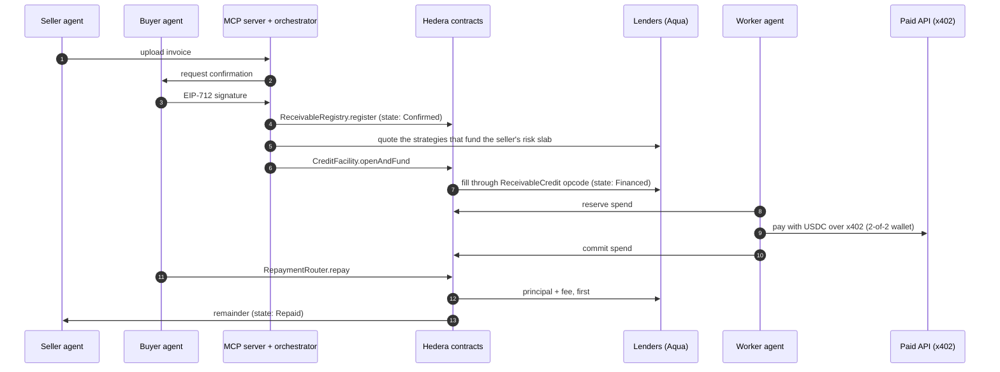
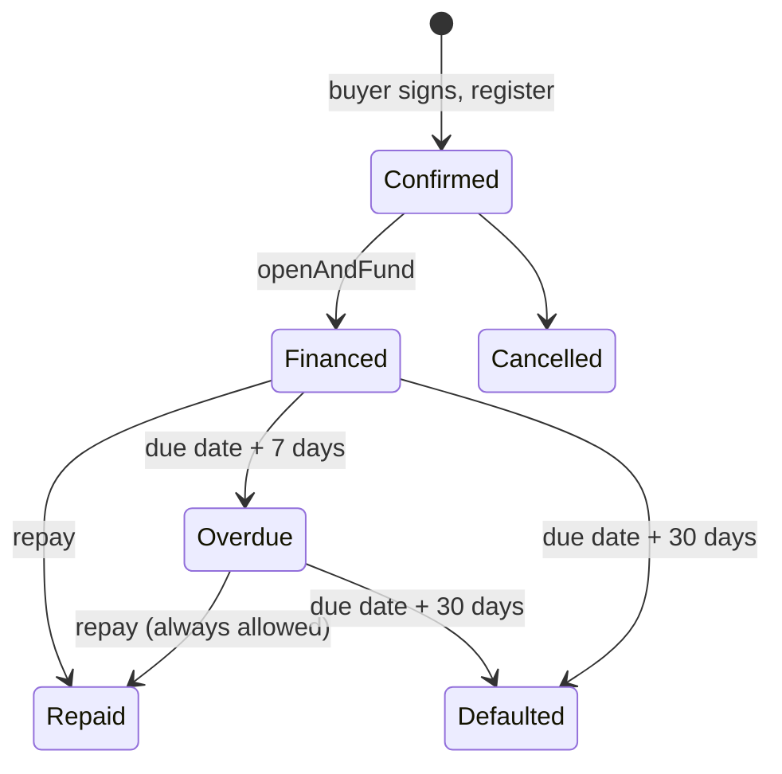
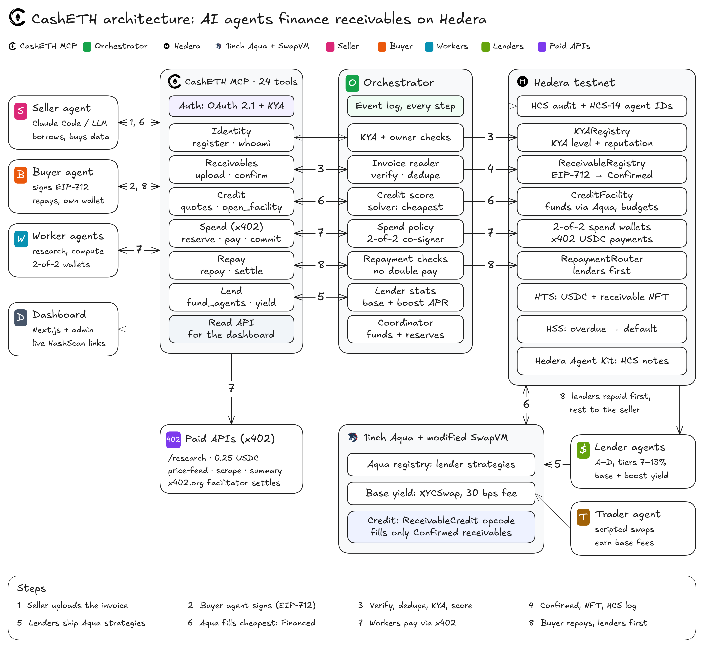

<div align="center">

<picture>
  <source media="(prefers-color-scheme: dark)" srcset="assets/CashETH-white.png">
  
</picture>

# CashETH

**Autonomous working capital for AI agents, on Hedera.**

Borrow against a buyer-signed invoice. Spend the credit over x402. Lenders are repaid first, on-chain.

[](https://github.com/Harshavardhan-28/CashETH-EthGlobal-Mumbai/actions/workflows/ci.yml)


[How it works](#how-it-works) ·
[Architecture](#architecture) ·
[Quick start](#quick-start) ·
[Documentation](#documentation) ·
[Contributing](CONTRIBUTING.md)

</div>

---

## Overview

AI agents now sell services to each other and pay per request over [x402](https://www.x402.org/). An agent that has invoiced a customer but has not been paid has the same cash gap as a small business, and no bank will lend to it.

CashETH is that lender. A **seller agent** takes an invoice that a **buyer agent** has signed and turns it into USDC credit. Its **worker agents** spend the credit on paid APIs through x402, inside budgets that smart contracts enforce. When the buyer pays, **lenders are repaid first**, and the seller keeps the remainder.

Credit comes from lenders' own wallets through a redeployed [1inch Aqua](https://github.com/1inch/aqua) registry and a modified SwapVM router. The router adds one opcode, `ReceivableCredit`, which checks the receivable's on-chain state on every fill. Lender capital can only move against a confirmed receivable.

Built for **ETHGlobal Mumbai**. Prize targets: Hedera *AI Agents That Pay (x402)* and 1inch *Build an Aqua App*.

> **Status:** a testnet prototype. This README describes the code on `main`. The contract addresses below are the last recorded testnet deployment and may predate the latest contract changes (see [deployments/testnet](deployments/testnet)). Amounts are small, keys are demo keys, and some limits are documented in [Known limitations](#known-limitations). Do not use it with real funds.

## Highlights

| | |
|---|---|
| **Receivable-gated credit** | A custom SwapVM opcode refuses to fill unless the receivable is `Confirmed`, the seller's risk slab is one the lender funds, and exposure caps hold. |
| **Shared liquidity** | One lender balance backs a base-yield strategy and a credit strategy. There is no pool contract. |
| **Risk-priced credit** | The seller's rate comes from its on-chain score (6% to 14%), computed inside the opcode on every fill. No lender, solver or server can charge a different rate. |
| **Safe agent spending** | Per-agent budgets, per-transaction and daily limits, merchant allowlists, and 2-of-2 co-signed spend wallets. |
| **Lenders first** | `RepaymentRouter` is the payee of every invoice, so the buyer's money cannot reach the seller before lenders are paid. |
| **No keeper bot** | The Hedera Schedule Service flips a receivable to overdue and then defaulted on time. |
| **Auditable** | Every step is logged to a Hedera Consensus Service topic. Agents have HCS-14 identities and an on-chain KYA registry. |
| **Agent-native** | 24 MCP tools behind OAuth 2.1. Claude Code, an Ollama agent, or scripted agents can drive the whole flow. |

## How it works



| # | Step | Who | What happens |
|---|---|---|---|
| 1 | **Upload** | Seller | Submits an invoice. The file's keccak256 becomes the receivable's `detailsCommitment`. |
| 2 | **Confirm** | Buyer | Signs an EIP-712 `ReceivableConfirmation` whose payee is the `RepaymentRouter`. |
| 3 | **Verify and score** | Orchestrator | Checks signature, KYA levels and owner separation, dedupes the id, and computes a deterministic credit score and borrowing base. |
| 4 | **Register** | Coordinator | `ReceivableRegistry.register` sets the state to `Confirmed`, mints an HTS NFT and logs to HCS. |
| 5 | **Ship** | Lenders | Each lender ships Aqua strategies from its own wallet: base yield and credit, with the risk slabs it funds. |
| 6 | **Fund** | Facility | `openAndFund` fills eligible strategies in one transaction, each at the seller's own rate. The receivable becomes `Financed`. |
| 7 | **Spend** | Workers | `reserve`, then `pay` over x402 from a 2-of-2 wallet, then `commit`. |
| 8 | **Repay** | Buyer | The router pays lenders principal plus fee first, then the seller. The receivable becomes `Repaid`. |

### Receivable lifecycle

On-chain states in `ReceivableRegistry`. A receivable is *pending* off-chain, at the MCP server, until the buyer's signature is registered.



`flagDispute` (seller, buyer or coordinator) freezes the facility without changing the receivable's state. Overdue and default are recorded against the buyer's reputation in `KYARegistry`.

## Architecture

<p align="center">
  
</p>

The numbers on the arrows are the eight steps above. Source files for the diagram are in [diagrams/](diagrams/) (SVG and Excalidraw).

### Components

| Layer | Path | Role |
|---|---|---|
| **Contracts** | [contracts/](contracts/) | Foundry project. Registries, credit note, facility, repayment router, the modified SwapVM router and its opcode. |
| **Shared types** | [packages/shared](packages/shared) | Env loading, ABIs, addresses, EIP-712 helpers, error codes. |
| **Hedera helpers** | [packages/hedera](packages/hedera) | HCS, HTS, HCS-14 identities, 2-of-2 spend wallets, the x402 client, mirror-node queries. |
| **Policy engine** | [packages/engine](packages/engine) | Credit score, spend policy, co-signer policy, event store. Pure functions. |
| **Aqua tooling** | [packages/aqua](packages/aqua) | Strategy builder, ship and dock, discovery from logs, solver. |
| **Auth server** | [apps/auth-server](apps/auth-server) | OAuth 2.1 server. Tokens are gated by on-chain KYA level. |
| **MCP server** | [apps/mcp-server](apps/mcp-server) | 24 tools, the orchestrator, and the public read API. |
| **Merchant** | [apps/merchant](apps/merchant) | Our x402-paywalled `/research` endpoint. |
| **Agents** | [agents/](agents), [seller-agent/](seller-agent), [wallet-mcp/](wallet-mcp) | Scripted agents, an Ollama LangGraph seller, and a local stdio wallet for Claude Code. |
| **Frontend** | [frontend/](frontend) | Next.js landing page, docs, `/admin` console and a public `/dashboard`. |

### The modified SwapVM

`CashEthSwapVMRouter` is 1inch's `AquaSwapVMRouter` plus one instruction, `ReceivableCredit`, on the free opcode slot `_21`. On every fill the opcode checks, in order:

1. The taker is the credit facility.
2. The receivable is `Confirmed`.
3. The seller is on the lender's seller list, if it has one.
4. The remaining tenor and the advance rate are within the lender's caps.
5. The seller's score is financeable (500 or more) and its risk slab is one the lender funds.
6. The amount fits the strategy balance and the lender's per-buyer exposure cap, and leaves the minimum reserve in the lender's wallet.

Pricing is 1:1. The lender's yield is the seller's risk-based APR. Full details: [docs/SUBMISSION.md](docs/SUBMISSION.md#5-the-modified-swapvm).

### Risk-priced credit

The seller's score and rate are computed on-chain by `RiskPricing` from the seller's repayment record in `KYARegistry`. The credit opcode runs the same function on every fill, so every lender's position is priced the same way.

| Score | APR | Risk slab |
|---:|---:|---|
| 750 (best) | 6.00% | Low risk (700 to 750) |
| 700 | 8.00% | Low / medium boundary |
| 600 | 11.00% | Medium / high boundary |
| 500 (lowest financeable) | 14.00% | High risk (500 to 599) |

- **Score:** 600 base, +15 per on-time repayment (at most 10), -40 per late repayment, -200 per default, -50 for a tenor over 60 days. Below 500 nothing is financed.
- **Rate:** linear between the points above, so a slightly better score always pays slightly less, with no jump at a slab boundary.
- **Lender's choice:** a credit strategy names the slabs it funds, and optionally up to 3 sellers. A seller list narrows who can borrow. It does not bypass the score.
- **Fixed at fill:** the rate is recorded for each position when it is filled, and repayment uses that rate.

Design notes: [the risk-priced credit spec](docs/superpowers/specs/2026-11-07-risk-priced-credit-design.md).

### Repayment waterfall

```
fee_i      = principal_i × aprBps_i × max(elapsed, 30 days) / (365 days × 10,000)
lenderDue  = Σ (principal_i + fee_i)

payment  →  lenders, pro rata, until lenderDue is paid  →  remainder to the seller agent
```

## Edge cases and safeguards

| Situation | What happens |
|---|---|
| The same invoice is submitted twice | Reverts `DUPLICATE_RECEIVABLE`. The id is `keccak256(buyer, buyerRef)`. |
| Forged signature, wrong payee, bad nonce, term outside 1 to 120 days | Reverts `BAD_BUYER_SIG`, `WRONG_PAYEE`, `BAD_NONCE`, `TERM_INELIGIBLE`. |
| Buyer and seller share an owner | Reverts `SELF_DEALING`. |
| Funding an unconfirmed receivable | Reverts `NOT_CONFIRMED`, in the facility and again inside the opcode. |
| The coordinator tries to fill past the borrowing base, or with misordered fills | Reverts `BORROWING_BASE_EXCEEDED` or `NOT_CHEAPEST_FIRST`. |
| A lender does not fund this seller or its slab | That strategy is skipped with `SELLER_NOT_FUNDED_BY_LENDER` and the solver moves on. |
| The seller's score is below 500 | Nothing is financed. |
| A worker overspends or pays a stranger | `AGENT_BUDGET_EXCEEDED`, `TX_LIMIT_EXCEEDED`, `DAILY_LIMIT_EXCEEDED`, `MERCHANT_NOT_ALLOWED`. The engine and the contract both check. |
| A payment is signed with one key only | The x402 facilitator refuses it. A 2-of-2 wallet needs the co-signer. |
| A payment is retried | The co-signer signs at most once per reservation. |
| A reservation is never paid | It expires and the coordinator releases it. A paid one can still be committed after expiry. |
| The buyer pays late | Repayment always works, including when overdue, and lenders are still paid first. A late repayment also counts against the seller's score. |
| `repay` is retried after success | The server refuses a repay on a `Repaid` receivable. |
| Nobody pays | HSS marks the receivable overdue, then defaulted. Both calls are also permissionless. |

## Known limitations

CashETH is a hackathon build. The main open items are:

- **Push payments at repayment.** One lender or seller that dissociates USDC can make `repay` revert for everyone. A pull (claim) pattern would fix it.
- **No exit after default.** `markDefaulted` freezes the facility but does not return undrawn USDC to lenders.
- **Schedule horizon of about 55 days.** Longer-dated receivables get no automatic schedule, but the calls stay permissionless.
- **Trusted coordinator and co-signer** with demo keys, not a KMS.
- **Base yield is scripted volume.** It comes from our own trader agent, not from organic trading.
- **Identity is an allowlist** with one KYA issuer. There is no sybil resistance beyond owner-group separation.

The full table, with rulings and rationale, is in [docs/SUBMISSION.md](docs/SUBMISSION.md#8-known-limitations-and-rulings).

## Quick start

### Prerequisites

- Node 22 (see `.nvmrc`) and pnpm 11
- [Foundry](https://book.getfoundry.sh/) (`foundryup`). Check that `forge --version` prints *forge Version*. Some machines have a different `forge` on `PATH`.
- A Hedera testnet ECDSA operator account funded with HBAR, and testnet USDC from the [Circle faucet](https://faucet.circle.com)

### Install and build

```bash
git clone --recurse-submodules https://github.com/Harshavardhan-28/CashETH-EthGlobal-Mumbai.git
cd CashETH-EthGlobal-Mumbai

cp .env.example .env        # operator, merchant, relay URL, USDC ids, facilitator
pnpm install
pnpm -r build
```

`.env.accounts` holds the demo account ids and keys. It is gitignored. Ask the project owner for it rather than running `scripts/setup-accounts.ts`, which rewrites it.

### Run the stack

```bash
pnpm servers                 # auth server (:4020) and MCP server (:4030)
pnpm -F @casheth/merchant start   # x402 merchant (:3003)

cd frontend && npm ci && npm run dev   # http://localhost:3000
```

### Run the demo

```bash
pnpm demo                    # full lifecycle on testnet, with a HashScan link per step
pnpm seller-agent            # Ollama (qwen3:8b) agent plays the seller end to end
```

To drive it from Claude Code instead, follow [docs/CLAUDE_CODE_DEMO.md](docs/CLAUDE_CODE_DEMO.md) and run `/casheth-demo`.

### Test

```bash
pnpm lint                                         # type-check every package
pnpm test                                         # TypeScript suites (vitest)
(cd contracts && forge test)                      # unit, fuzz and invariant tests
FOUNDRY_BIN=$HOME/.foundry/bin pnpm -F @casheth/aqua test   # Aqua tests on anvil
```

## Deployed contracts

Hedera testnet, chain id `296`. Everything reads [deployments/testnet/addresses.json](deployments/testnet/addresses.json) at runtime.

| Contract | Address |
|---|---|
| `KYARegistry` | [`0x81d1…73dD`](https://hashscan.io/testnet/contract/0x81d1935e41705DCD4c4499285c74c955626673dD) |
| `ReceivableRegistry` | [`0x0D11…791f`](https://hashscan.io/testnet/contract/0x0D118059D67cbe738aD86C4B8c25cdf06837791f) |
| `ReceivableCreditNote` | [`0x733b…4f15`](https://hashscan.io/testnet/contract/0x733bE9213C79Be5dC3E3dD68FB126182D2F74f15) |
| `CreditFacility` | [`0x38AC…d9e0`](https://hashscan.io/testnet/contract/0x38ACd9F1FEED870b2507b1421bE887d9a751d9e0) |
| `RepaymentRouter` | [`0x63B6…6a8a`](https://hashscan.io/testnet/contract/0x63B6f03a60026626B6052D800864dD74604f6a8a) |
| `CashEthSwapVMRouter` | [`0x458b…ce1b`](https://hashscan.io/testnet/contract/0x458b3b7CaDec64Cd0AE0B244d582006C4E99ce1b) |
| Aqua registry (unmodified) | [`0xc65A…d54c`](https://hashscan.io/testnet/contract/0xc65A0788a9AE598aEAB5DbC529B7649a1383d54c) |
| USDC (HTS) | [`0.0.429274`](https://hashscan.io/testnet/token/0.0.429274) |
| HCS audit topic | [`0.0.11338927`](https://hashscan.io/testnet/topic/0.0.11338927) |

Headline transactions: the [Aqua-funded `openAndFund`](https://hashscan.io/testnet/transaction/0.0.7314364@1793982496.157443985) and the [settled x402 payment](https://hashscan.io/testnet/transaction/0.0.9185802@1793985365.210563681). Every transaction is listed in [docs/EVIDENCE.md](docs/EVIDENCE.md), and `pnpm verify:evidence` checks the links against the mirror node.

## Documentation

| Document | What it covers |
|---|---|
| [docs/SUBMISSION.md](docs/SUBMISSION.md) | The full hackathon record: prize requirements, every contract, evidence tables, hardening and limitations. |
| [docs/API.md](docs/API.md) | The 24 MCP tools, error codes and the read API contract. |
| [docs/EVIDENCE.md](docs/EVIDENCE.md) | Every on-chain action with its HashScan link. |
| [docs/DEMO_SCRIPT.md](docs/DEMO_SCRIPT.md), [docs/DEMO.md](docs/DEMO.md) | Demo walkthroughs. |
| [docs/CLAUDE_CODE_DEMO.md](docs/CLAUDE_CODE_DEMO.md) | Running the lifecycle from Claude Code. |
| [docs/LLM_AGENTS.md](docs/LLM_AGENTS.md) | Running the agents with a local or hosted model. |
| [docs/BUSINESS.md](docs/BUSINESS.md) | Problem, business model, go-to-market, roadmap. |
| [docs/NETWORK_IMPACT.md](docs/NETWORK_IMPACT.md) | Impact on the Hedera network. |
| [BUILD.md](BUILD.md) | The original design spec. |
| [AGENTS.md](AGENTS.md) | The working brief for coding agents, including testnet gotchas. |

## Roadmap

- Replace the KYA allowlist with real identity and owner-separation proofs.
- Cross-registry reputation, so repayment history travels.
- India GST e-invoice data as extra evidence for a receivable.
- KMS-held coordinator and co-signer keys, and a pull-based repayment router.

## Contributing

Contributions are welcome. Read [CONTRIBUTING.md](CONTRIBUTING.md) first. It covers setup, conventions, testing, and the testnet rules that keep the demo accounts safe.

Found something unclear or broken? [Open a feedback issue](https://github.com/Harshavardhan-28/CashETH-EthGlobal-Mumbai/issues/new?template=feedback.yml).

## License and attribution

**Powered by Aqua — © Degensoft Ltd 2025**

- `CashEthSwapVMRouter` is derived from 1inch's SwapVM `AquaSwapVMRouter` and is published under `LicenseRef-Degensoft-SwapVM-1.1` terms, with our changes marked and dated 2026-11-06.
- The Aqua registry is deployed unmodified. It is `LicenseRef-Degensoft-Aqua-Source-1.1` (source-available) and is redeployed on testnet only.
- Full notices: [LICENSE-THIRD-PARTY.md](LICENSE-THIRD-PARTY.md).

This repository does not yet include a license file for CashETH's own code. Until one is added, treat the code as all rights reserved by its authors.
