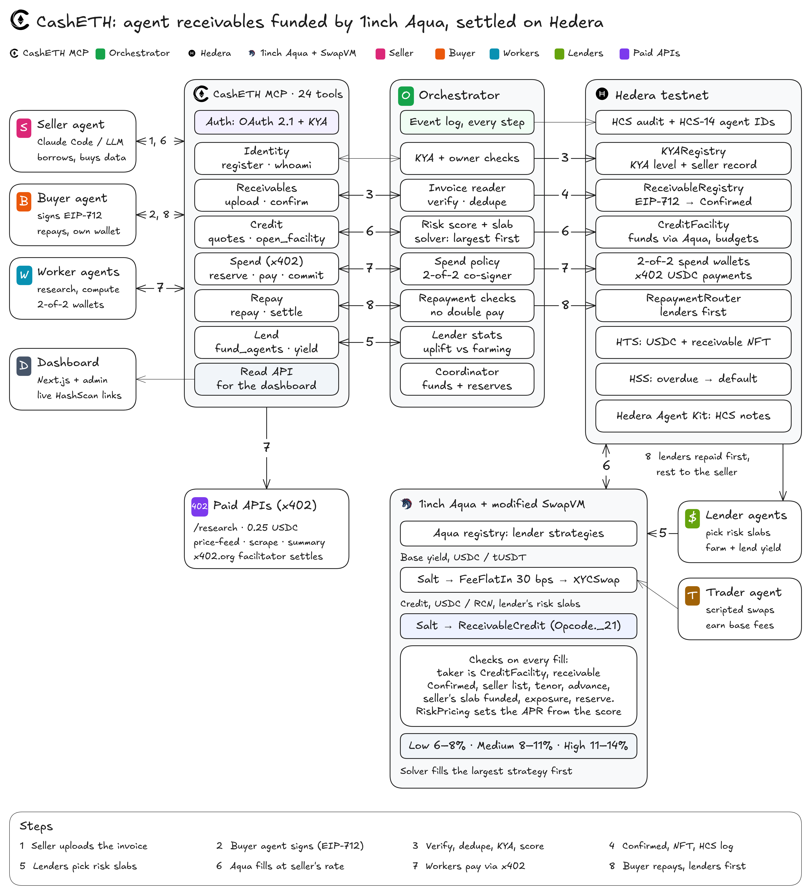
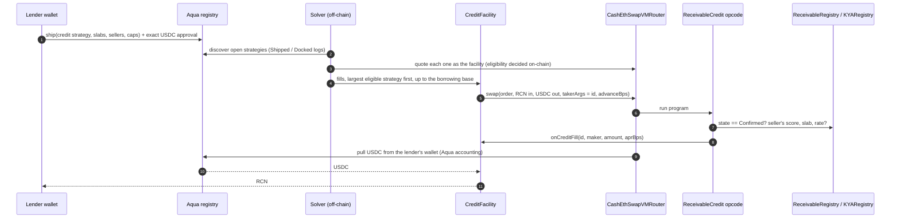

# CashETH on 1inch: Build an Aqua App

How CashETH uses 1inch Aqua and SwapVM, mapped to the requirements of the 1inch track *Build an Aqua App* at ETHGlobal Mumbai.

**In one line:** CashETH turns a lender's idle USDC into a **receivable-backed credit line**, written as a SwapVM program on Aqua. A new SwapVM instruction, `ReceivableCredit`, lets lender capital move only to the CashETH credit facility. It moves only against an invoice that a buyer has signed on-chain, and only at the rate the seller's on-chain credit score sets. The same wallet balance also backs a regular constant-product strategy that earns swap fees.

Powered by Aqua — © Degensoft Ltd 2025

<p align="center">
  
</p>

## Contents

1. [Qualification requirements](#1-qualification-requirements)
2. [The DeFi position](#2-the-defi-position)
3. [The modified SwapVM](#3-the-modified-swapvm)
4. [Risk-priced credit inside the opcode](#4-risk-priced-credit-inside-the-opcode)
5. [How a fill happens](#5-how-a-fill-happens)
6. [On-chain token transfers](#6-on-chain-token-transfers)
7. [Tests](#7-tests)
8. [Aqua SDK and tooling](#8-aqua-sdk-and-tooling)
9. [Run it yourself](#9-run-it-yourself)
10. [Limits and honest notes](#10-limits-and-honest-notes)
11. [License and attribution](#11-license-and-attribution)

## 1. Qualification requirements

| Requirement | How CashETH meets it | Evidence |
|---|---|---|
| Official Aqua / SwapVM contracts (redeploying a modified SwapVM is allowed) | The **Aqua registry is the official contract, deployed unmodified** from the `1inch/aqua` submodule. `CashEthSwapVMRouter` is 1inch's `AquaSwapVMRouter` from the `1inch/swap-vm` submodule, with one added instruction and no other logic changes. | Aqua [0xc65A…d54c](https://hashscan.io/testnet/contract/0xc65A0788a9AE598aEAB5DbC529B7649a1383d54c), router [0x458b…ce1b](https://hashscan.io/testnet/contract/0x458b3b7CaDec64Cd0AE0B244d582006C4E99ce1b) |
| On-chain token transfers shown in the demo (local forks are fine) | Real USDC (an HTS token) moves from lender wallets into the credit facility through Aqua fills on **Hedera testnet**, not a fork. Base-yield swaps move USDC and tUSDT. | [`openAndFund`](https://hashscan.io/testnet/transaction/0.0.7314364@1793982496.157443985), [section 6](#6-on-chain-token-transfers) |
| Positions shown through test scripts or a UI | Foundry tests, anvil-backed TypeScript tests of the full Aqua flow, testnet scripts, and a UI: the lender console in `/dashboard` shows each lender's strategies, positions, slabs and yields. | [Section 7](#7-tests), `frontend/` |
| Use of SwapVM (scored higher) | A **custom opcode** (`ReceivableCredit`, slot `_21`) and a custom SwapVM program for credit, alongside the stock `XYCSwap` + `FeeFlatIn` program for base yield | [Section 3](#3-the-modified-swapvm) |
| Proper git history, not one commit on the final day | Around 190 commits across the event (2026-11-06 and 2026-11-07), from five contributors, with conventional messages | `git log` |

## 2. The DeFi position

A CashETH lender is not a pool depositor. Its USDC stays **in its own wallet**, and Aqua tracks virtual balances for the strategies it ships. One balance backs two strategies at once ("shared liquidity"):

| Strategy | SwapVM program | Pair | What the lender earns |
|---|---|---|---|
| **Base yield** | `Salt ‖ FeeFlatIn(30 bps) ‖ XYCSwap` (stock instructions) | USDC / tUSDT, constant product | Swap fees from takers. Variable. |
| **Credit** | `Salt ‖ ReceivableCredit(args)` (our instruction) | USDC / RCN | The seller's risk-based APR, between 6% and 14%, fixed when the fill happens and paid back first at repayment |

Here is how the credit position works, step by step:

1. **Ship.** The lender ships a credit strategy. Its arguments say which risk slabs the lender funds (low, medium or high), and optionally up to 3 sellers. They also set caps on tenor, advance rate, per-buyer exposure and a minimum reserve kept in the wallet. Shipping moves no funds.
2. **Fill.** When a buyer-confirmed receivable is ready, the **credit facility** is the only allowed taker. It fills the strategy and sells the lender **Receivable Credit Notes (RCN)** 1:1 for USDC, so the lender's wallet pays the USDC and the lender receives RCN.
3. **Record.** The opcode reports `(id, maker, amount, aprBps)` to the facility, which records the position at that rate.
4. **Repay.** When the buyer pays, `RepaymentRouter` pays every lender principal plus fee first: `fee = principal × aprBps × max(elapsed, 30 days) / (365 days × 10,000)`. The seller gets the remainder.

So the same dollar can earn swap fees while it is idle and credit yield while it is lent, without leaving the lender's wallet until the moment it is needed. The lender's view in `/dashboard` shows "Farming only" next to "Farming + lending" APR, and the extra the lender earned from lending.

## 3. The modified SwapVM

| Item | Value |
|---|---|
| Contract | [contracts/src/aqua/CashEthSwapVMRouter.sol](../contracts/src/aqua/CashEthSwapVMRouter.sol): `is Simulator, SwapVM, AquaOpcodes`, the same base and constructor arguments as 1inch's `AquaSwapVMRouter` |
| New instruction | [contracts/src/aqua/ReceivableCredit.sol](../contracts/src/aqua/ReceivableCredit.sol) on the free slot `Opcode._21` of the conditions bank, written in the SwapVM instruction-library style (`CalldataParse`, `MemoryPtr`, `InstructionBuilder`) |
| Pricing library | [contracts/src/core/libs/RiskPricing.sol](../contracts/src/core/libs/RiskPricing.sol), called by the opcode |
| Removed | `XYCConcentrateSwap`, so the runtime fits EIP-170: 24,650 B with it and 23,759 B without, against a 24,576 B limit. A program that uses it reverts `UnknownOpcode`. CashETH ships no concentrated strategies. |
| Added state and views | Immutables `REGISTRY`, `KYA`, `FACILITY`. `exposure(maker, buyer)`: how much a lender has advanced against a buyer in total, kept in its own storage slot `keccak256("casheth.ReceivableCredit.v1")` |
| Order building | All order and taker bytes are built on-chain by [CashEthOrderBuilder.sol](../contracts/src/aqua/CashEthOrderBuilder.sol) through `eth_call`, so nothing is hand-encoded off-chain |
| Taker gate | The default 1inch taker gate (a KYC NFT check) is replaced by `taker == facility`. Identity checks (KYA levels, owner separation, buyer signature) already ran when the receivable was registered. |

### What `ReceivableCredit` checks on every fill

The first failing check reverts the whole swap.

1. `taker == facility`: only the CashETH credit facility can fill a credit strategy.
2. The taker args are exactly `[bytes32 receivableId, uint16 advanceBps]`, which is what the facility vouches for.
3. `ReceivableRegistry.get(id).state == Confirmed`: without a buyer-signed, registered receivable, no USDC moves.
4. If the lender named sellers, the seller must be one of them. The list narrows who can borrow, and the score still applies.
5. The remaining tenor is positive and at most `maxTenorDays`.
6. `advanceBps <= maxAdvanceBps`.
7. The seller's score, computed from its on-chain record in `KYARegistry` and the tenor, is 500 or more, and its slab is one the lender funds (`slabMask`). Otherwise the fill fails with `SELLER_NOT_FUNDED_BY_LENDER`.
8. The output token is the receivable's currency (USDC), and the direction is RCN → USDC.
9. The amount fits the strategy's Aqua balance and the lender's per-buyer exposure cap, and leaves at least `minReserve` USDC in the lender's wallet. Otherwise the fill fails with `LENDER_RESERVE_TOO_LOW`.

On a real swap (not a `quote`), the opcode adds the amount to `exposure[maker][buyer]` and calls `facility.onCreditFill(id, maker, amount, aprBps)`.

Argument encoding (packed, big-endian, 37 + 20·n bytes):

```
offset  0  uint16  maxTenorDays
offset  2  uint16  maxAdvanceBps
offset  4  uint128 maxPerBuyer
offset 20  uint8   slabMask        bit 0 low, bit 1 medium, bit 2 high (1..7)
offset 21  uint128 minReserve
offset 37  address sellerSet[n]    n in 0..3
```

## 4. Risk-priced credit inside the opcode

The price is not set by the lender, the solver or our server. `RiskPricing` computes it inside the opcode from on-chain data on every fill, so every lender that funds a receivable earns the same rate for it.

| Score | APR | Slab |
|---:|---:|---|
| 750 (best) | 6.00% | Low risk (700 to 750) |
| 700 | 8.00% | Low / medium boundary |
| 600 | 11.00% | Medium / high boundary |
| 500 (lowest financeable) | 14.00% | High risk (500 to 599) |

- **Score:** 600 to start, plus 15 per on-time repayment (counting at most 10), minus 40 per late repayment, minus 200 per default, and minus 50 for a tenor over 60 days.
- **Rate:** linear between the breakpoints, so a slightly better seller always pays slightly less, with no jump at a slab boundary.
- **Same numbers everywhere:** the TypeScript engine (`packages/engine/src/pricing.ts`) mirrors the Solidity library, and a shared table of cases is tested in both.

Design and decisions: [the risk-priced credit spec](superpowers/specs/2026-11-07-risk-priced-credit-design.md).

## 5. How a fill happens



`CreditFacility.openAndFund` does all the fills for one receivable in one transaction. It checks the fills again: they must be ordered by rate (`NOT_CHEAPEST_FIRST`), the total must stay within the borrowing base (`BORROWING_BASE_EXCEEDED`), and each fill's maker and rate must equal what the opcode reported (`FILL_MISMATCH`). The coordinator therefore cannot overpay a lender or skip the opcode's price. If a strategy doesn't fund this seller or its slab, the solver skips it, and the chain would reject it anyway.

## 6. On-chain token transfers

Everything below ran on **Hedera testnet** (chain 296) with real HTS USDC (`0.0.429274`).

| What | Transaction |
|---|---|
| Spike S1: Aqua + stock SwapVM on Hedera, first `ship` | [0.0.7314364@1793963071.121512471](https://hashscan.io/testnet/transaction/0.0.7314364@1793963071.121512471) |
| Spike S1: first fill. The HTS child transfer debits the lender's allowance (`is_approval: true`). | [0.0.7314364@1793963078.419965153](https://hashscan.io/testnet/transaction/0.0.7314364@1793963078.419965153) |
| Lender A ships a 3.5 USDC credit strategy | [0.0.7314364@1793980834.590739155](https://hashscan.io/testnet/transaction/0.0.7314364@1793980834.590739155) |
| Lender A ships a base-yield strategy (0.5 USDC + 0.5 tUSDT) | [0.0.7314364@1793980911.340291226](https://hashscan.io/testnet/transaction/0.0.7314364@1793980911.340291226) |
| **`openAndFund` through the modified router:** lender A fills 3.5 USDC and lender B 1.0 USDC against PO-1002, and the receivable becomes `Financed`. Lender C was not needed, and lender D was skipped by the opcode (`SELLER_NOT_FUNDED_BY_LENDER`). | [0.0.7314364@1793982496.157443985](https://hashscan.io/testnet/transaction/0.0.7314364@1793982496.157443985) |
| The facility refuses to fund an unregistered id (`NOT_CONFIRMED`) | [0.0.7314364@1793982511.134508238](https://hashscan.io/testnet/transaction/0.0.7314364@1793982511.134508238) |
| Base-yield swap USDC → tUSDT against lender A's strategy | [0xc4c8…8054](https://hashscan.io/testnet/transaction/0xc4c8d83194af6e353bde45c2ed3a4190305f432e38d88ac0fcc88eea48de8054) |
| Base-yield swap tUSDT → USDC | [0x43bd…a3b6](https://hashscan.io/testnet/transaction/0x43bdd259db898355c076f5803f81e9d28d7e545008ae91328d0874d654a2a3b6) |
| One balance backs two credit strategies (lender A, second ship) | [0.0.7314364@1793989997.263905540](https://hashscan.io/testnet/transaction/0.0.7314364@1793989997.263905540) |
| Full lifecycle driven by Claude Code: Aqua funding, then a repayment that pays lenders first | [funding](https://hashscan.io/testnet/transaction/0xd04beb759bdf890a4968be001705b71fca9e1950cc20be9d9b1d9ed38efc04df), [repayment](https://hashscan.io/testnet/transaction/0x21e99be537f5673a192c6be9236aa533c699825dd4c223d161cdaab50d03c92c) |

Every link is listed with context in [EVIDENCE.md](EVIDENCE.md) (sections "Spike S1", "C4 strategies (final)", "C4 funding" and "C4 base yield"), and `pnpm verify:evidence` checks each one against the mirror node.

## 7. Tests

| Suite | What it proves | Run |
|---|---|---|
| [ReceivableCredit.t.sol](../contracts/test/ReceivableCredit.t.sol) | Each opcode check, in order: taker gate, `Confirmed` state, seller list, tenor, advance, slab, exposure and reserve, plus the encoding round trip | `forge test --match-contract ReceivableCredit` |
| [RiskPricing.t.sol](../contracts/test/RiskPricing.t.sol) | Score and rate breakpoints, continuity across slabs, the cutoff below 500 (the same table as the TypeScript engine) | `forge test --match-contract RiskPricing` |
| [CashEthSwapVMRouter.t.sol](../contracts/test/CashEthSwapVMRouter.t.sol) | The router still runs stock Aqua programs (`XYCSwap`) and dispatches `_21` to the new instruction. The order builder round-trips, and an order hash equals Aqua's strategy hash. End to end with the real router: `openAndFund` fills A and B and skips C. It reverts on an unconfirmed id or a taker other than the facility, and on a strategy that skips the seller's slab. It skips a lender that does not fund the seller, and the coordinator cannot charge a different rate. | `forge test --match-contract CashEthSwapVMRouter` |
| [contracts/test/invariants/](../contracts/test/invariants) | Fuzz and invariant tests: debt never exceeds the borrowing base, the seller gets nothing while lenders are owed, and state only moves forward | `forge test` |
| [packages/aqua/src/aqua.anvil.test.ts](../packages/aqua/src/aqua.anvil.test.ts) | End to end on anvil with the real Aqua and router, in five steps. Ship with slab masks and seller lists. Discover the strategies from logs, with the strategy hash equal to the `Shipped` event's hash. The solver fills the seller's slab at the seller's rate, largest first. The chain, not the caller, decides the rate and the slab. Then `openAndFund` funds the receivable on-chain. | `FOUNDRY_BIN=$HOME/.foundry/bin pnpm -F @casheth/aqua test` |
| [packages/aqua/src/solver.test.ts](../packages/aqua/src/solver.test.ts) | Slab and seller filtering, largest strategy first, borrowing base | `pnpm -F @casheth/aqua test` |

`forge test` runs about 190 Solidity tests (unit, fuzz and invariant).

## 8. Aqua SDK and tooling

[`packages/aqua`](../packages/aqua) is the lender and solver toolkit:

| File | Role |
|---|---|
| `ship.ts` | Lender writes: exact-amount USDC approvals to Aqua (HTS allowances are int64, so never a max approval), plus `ship` and `dock` calldata from **`@1inch/aqua-sdk` 0.4.0** |
| `discover.ts` | Finds open strategies from Aqua's `Shipped` and `Docked` logs, decoded with the SDK's `ShippedEvent` and `DockedEvent`, then enriches them with balances and decoded credit args |
| `orderBuilder.ts` | Calls `CashEthOrderBuilder` through `eth_call` to build orders and taker data |
| `solver.ts` | Picks the strategies that fund the seller's slab and list, quotes each one through the router as the facility, and fills the largest first up to the borrowing base |

Lenders drive this through the MCP tool `fund_agents` (`slabs: ["low" | "medium" | "high"]`, optional `sellers`) and `close_strategy` (dock). The full tool list is in [API.md](API.md).

## 9. Run it yourself

```bash
git clone --recurse-submodules https://github.com/Harshavardhan-28/CashETH-EthGlobal-Mumbai.git
cd CashETH-EthGlobal-Mumbai/contracts
forge build --sizes | grep CashEthSwapVMRouter   # under the 24,576 B limit
forge test                                       # opcode, pricing, router, invariants

cd .. && pnpm install && pnpm -r build
FOUNDRY_BIN=$HOME/.foundry/bin pnpm -F @casheth/aqua test   # Aqua flow on anvil

pnpm servers && pnpm demo                        # the testnet lifecycle (needs .env.accounts)
```

Then open `http://localhost:3000/dashboard` (`cd frontend && npm run dev`) and pick a lender. The lender console shows its liquidity, its positions with their rates, the slabs it funds, every seller's score, slab and rate, and farming against lending.

## 10. Limits and honest notes

- **Two versions of the opcode.** The testnet stack in [deployments/testnet/addresses.json](../deployments/testnet/addresses.json) was deployed on 2026-11-06. Its opcode version used fixed lender tiers (7%, 8.5% and 13%) instead of score-based slabs, and all the transactions in [section 6](#6-on-chain-token-transfers) ran on it. Risk-priced credit (sections 3 and 4) is on `main` and covered by the Foundry and anvil suites. Its testnet redeploy is scripted (`scripts/c4-redeploy-prepare.ts`, then the `c2` to `c4` drivers) but had not run when this was written.
- **Base yield is scripted volume.** The swaps against base-yield strategies come from our own trader agent, not organic flow, so the measured base APR proves the mechanism works, not that it will earn that much.
- **No concentrated liquidity**, because `XYCConcentrateSwap` was dropped to fit EIP-170.
- **Trusted coordinator.** The coordinator submits `openAndFund` with a demo key. The opcode and facility checks limit what it can do: it cannot fund an unconfirmed receivable, exceed the borrowing base or change the rate.

The full list of limitations is in [SUBMISSION.md section 8](SUBMISSION.md#8-known-limitations-and-rulings).

## 11. License and attribution

**Powered by Aqua — © Degensoft Ltd 2025**

- `CashEthSwapVMRouter` and `ReceivableCredit` are derived from 1inch SwapVM and published under `LicenseRef-Degensoft-SwapVM-1.1` terms, with our changes marked and dated 2026-11-06.
- The Aqua registry is deployed unmodified. It is `LicenseRef-Degensoft-Aqua-Source-1.1` (source-available) and is redeployed on testnet only.
- Full notices: [LICENSE-THIRD-PARTY.md](../LICENSE-THIRD-PARTY.md).
