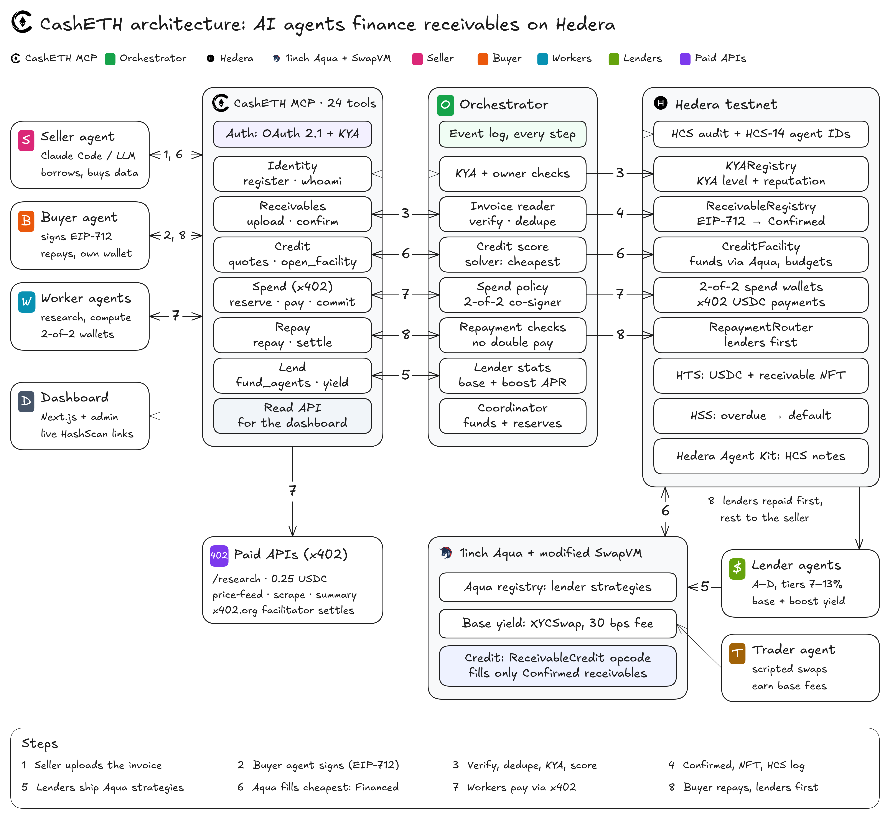

# CashETH on Hedera: AI Agents That Pay (x402)

How CashETH uses Hedera, mapped to the requirements of the Hedera track *AI Agents That Pay: x402 on Hedera* at ETHGlobal Mumbai. Every claim links to a Hedera testnet transaction or to the code that makes it.

**In one line:** AI agents borrow USDC against a buyer-signed invoice, and their worker agents spend that credit on paid APIs over x402. Payments settle in HTS USDC on Hedera testnet, under budgets that a contract and a co-signer both enforce, and each step is logged to an HCS topic.

<p align="center">
  
</p>

## Contents

1. [Qualification requirements](#1-qualification-requirements)
2. [Extra points](#2-extra-points)
3. [The payment flow](#3-the-payment-flow)
4. [Hedera services we use](#4-hedera-services-we-use)
5. [Spending controls](#5-spending-controls)
6. [Run it yourself](#6-run-it-yourself)
7. [Where the code is](#7-where-the-code-is)
8. [What we learned about Hedera](#8-what-we-learned-about-hedera)

## 1. Qualification requirements

| Requirement | How CashETH meets it | Evidence |
|---|---|---|
| At least one x402-protected endpoint that settles on Hedera through a listed facilitator | **Two merchants.** Our own `apps/merchant` (`GET /research`, 0.25 USDC). A teammate's `casheth-paid-apis`, live on Cloud Run (`/price-feed` $0.50, `/web-scrape` $1.00, `/llm-summary` $2.00). Both use scheme `exact` on network `hedera:testnet`, take USDC `0.0.429274`, and settle through the official facilitator `https://x402.org/facilitator`. | Settled payments [0.0.9185802@1793985365.210563681](https://hashscan.io/testnet/transaction/0.0.9185802@1793985365.210563681) and [0.0.9185802@1794005127.517122456](https://hashscan.io/testnet/transaction/0.0.9185802@1794005127.517122456) (fee payer `0.0.9185802` is the facilitator) |
| An agent finds the endpoint and completes a paid request end to end, with no human approving | The worker agent reads each merchant's catalogue, picks the cheapest offer for the service, and then runs reserve → pay → commit on its own. The co-signer is a policy engine, not a person. | [x402 settlement](https://hashscan.io/testnet/transaction/0.0.9185802@1793985365.210563681) between [reserve](https://hashscan.io/testnet/transaction/0.0.7314364@1793985356.566369946) and [commit](https://hashscan.io/testnet/transaction/0.0.7314364@1793985376.841020355) |
| Public repo with a README covering setup, architecture and the payment flow, including a settled payment's Hedera transaction id | [README](../README.md) (setup, architecture, flow), this document (payment flow), [EVIDENCE.md](EVIDENCE.md) (every transaction) | Settled payment id: **`0.0.9185802@1793985365.210563681`** |
| Demo video of 5 minutes or less, showing a payment settling and linked on HashScan | The script is [DEMO_SCRIPT.md](DEMO_SCRIPT.md). The public `/dashboard` shows each MCP call with its HashScan link. | Video link: *added with the submission* |

### The headline payment

The research worker's spend wallet [0.0.11339484](https://hashscan.io/testnet/account/0.0.11339484) paid **0.25 USDC** to merchant [0.0.11333304](https://hashscan.io/testnet/account/0.0.11333304) for `GET /research`. The payment details:

- **Facilitator:** `https://x402.org/facilitator` settled it.
- **Signers:** the wallet is 2-of-2 (worker plus co-signer), and both keys signed.
- **Proof:** the settlement id came back in the `PAYMENT-RESPONSE` header and was then written on-chain by `commit_spend` (`CreditFacility.commit`).

| Leg | Hedera transaction |
|---|---|
| `CreditFacility.reserve` moves exactly 0.25 USDC into the spend wallet | [0.0.7314364@1793985356.566369946](https://hashscan.io/testnet/transaction/0.0.7314364@1793985356.566369946) (HCS `SpendReserved`, seq 44) |
| x402 settlement by the facilitator | [0.0.9185802@1793985365.210563681](https://hashscan.io/testnet/transaction/0.0.9185802@1793985365.210563681) |
| `CreditFacility.commit` records `keccak256(settlement id)` | [0.0.7314364@1793985376.841020355](https://hashscan.io/testnet/transaction/0.0.7314364@1793985376.841020355) (HCS `SpendCommitted`, seq 45) |

A second payment came from the full lifecycle driven by Claude Code as the seller agent (PO-CC-11062242). It went from the buyer's confirmation, through funding, an x402 purchase and the commit, to the repayment:

- [funding](https://hashscan.io/testnet/transaction/0xd04beb759bdf890a4968be001705b71fca9e1950cc20be9d9b1d9ed38efc04df)
- [x402 settlement](https://hashscan.io/testnet/transaction/0.0.9185802@1794005127.517122456)
- [repayment](https://hashscan.io/testnet/transaction/0x21e99be537f5673a192c6be9236aa533c699825dd4c223d161cdaab50d03c92c)

## 2. Extra points

| Extra point | Status | What we built | Evidence |
|---|---|---|---|
| Spending controls: budgets, per-merchant limits, allowlists, human approval above an amount | **Done** | Per-agent budget, per-transaction and daily limits, a merchant allowlist, a facility-wide ceiling, and one open reservation per wallet. A 2-of-2 wallet whose co-signer signs only a payment that matches the reservation. The limits are checked twice, in the engine and in the contract. | [Section 5](#5-spending-controls) |
| Agent identity and reputation (HCS-14 or ERC-8004) | **Done** | Each agent has an HCS-14 UAID, built with `@hashgraphonline/standards-sdk` and published on the audit topic. `KYARegistry` (shaped like ERC-8004) holds the KYA level, owner group and repayment record (on time, late, defaults). That record sets the seller's credit score and rate. | [EVIDENCE.md, "C2: HCS topic, HCS-14 profiles"](EVIDENCE.md#c2-hcs-topic-hcs-14-profiles-and-receivable-nft-collection) |
| HCS topic as a tamper-evident audit log of agent spending | **Done** | Topic [0.0.11338927](https://hashscan.io/testnet/topic/0.0.11338927) (no admin key; the operator holds the submit key) logs `SpendReserved`, `SpendCommitted`, `SpendRejected`, `SpendReleased` and every receivable event. Only hashes go on it, never invoice contents. | `SpendRejected` seq 46 and 47, `SpendReleased` seq 53 |
| Settling in an HTS token such as USDC | **Done** | Every payment, credit line and repayment is in HTS USDC [0.0.429274](https://hashscan.io/testnet/token/0.0.429274), through its EVM facade `0x…068cDa`. | All the transactions above |
| Hedera Agent Kit or Hedera Network MCP | **Done (Agent Kit)** | `agents/src/kit.ts` gives each agent a `hedera-agent-kit` 3.8.2 instance that runs as the agent's own account. Agents use the kit's `submit_topic_message_tool` (notes on an agent-notes topic) and `associate_token_tool` (HTS association). | [seller note signed by the seller account](https://hashscan.io/testnet/transaction/0.0.11337987@1793989248.358470711) |
| Scheduled Transactions | **Done (contract-scheduled lifecycle, not subscriptions)** | The credit facility schedules its own overdue and default checks through the Hedera Schedule Service system contract (`0x16b`, HIP-1215), so no keeper bot is needed. | Schedule [0.0.11342318](https://hashscan.io/testnet/schedule/0.0.11342318); spike: [executed by the network](https://hashscan.io/testnet/schedule/0.0.11338268), [deleted](https://hashscan.io/testnet/schedule/0.0.11338283) |
| Multi-agent negotiation (A2A or ACP) before payment | **Partial** | The seller and buyer agents agree on terms through MCP: the seller uploads, and the buyer signs an EIP-712 confirmation that fixes amount, due date and payee. The worker compares merchant prices before it buys. We do not use the A2A or ACP protocols. | `request_buyer_confirmation`, `confirm_receivable` in [API.md](API.md) |
| HTS custom fees to split revenue | **Not used** | Revenue is split by `RepaymentRouter` instead: lenders get principal plus fee first, and the seller gets the rest. | [repayment](https://hashscan.io/testnet/transaction/0x21e99be537f5673a192c6be9236aa533c699825dd4c223d161cdaab50d03c92c) |

## 3. The payment flow

Hedera's `exact` scheme has the client sign a `TransferTransaction` that debits its own account, and the facilitator pays the network fee. A smart contract cannot sign that transaction, so the credit facility cannot pay a merchant directly. CashETH bridges the gap with **2-of-2 co-signed spend wallets**.

```mermaid
sequenceDiagram
    autonumber
    participant W as Worker agent
    participant M as CashETH MCP server
    participant F as CreditFacility (Hedera)
    participant X as x402 merchant
    participant Fac as x402.org facilitator
    participant H as HCS audit topic

    W->>X: GET /research
    X-->>W: 402 + PAYMENT-REQUIRED (exact, hedera:testnet, USDC 0.0.429274, payTo, amount)
    W->>M: reserve_spend(merchant, amount)
    M->>M: engine checks budget, per-tx, daily, allowlist
    M->>F: reserve(...) (contract re-checks the same limits)
    F-->>W: exactly `amount` USDC into the 2-of-2 spend wallet
    M->>H: SpendReserved
    W->>M: pay_x402
    M->>M: worker signs; co-signer signs only if the bytes match the reservation
    W->>X: GET /research + PAYMENT-SIGNATURE
    X->>Fac: verify + settle
    Fac-->>X: Hedera transaction id
    X-->>W: 200 + data + PAYMENT-RESPONSE
    W->>M: commit_spend(settlement id)
    M->>F: commit(spendId, keccak256(id))
    M->>H: SpendCommitted
```

What the co-signer checks before it signs (`packages/engine` `approvePayment`, `packages/hedera/src/x402/cosignedSigner.ts`):

1. Scheme, network, asset, `payTo`, amount and payer all match the open reservation.
2. The transaction bytes move exactly that USDC to that payee and do nothing else.
3. It has not already signed for this reservation, so a retry cannot pay twice.

The spend wallet holds no balance between payments. The facility funds it just in time, so a leaked worker key alone cannot move money: the facilitator refuses a payment signed by one key ([spike S3](EVIDENCE.md#spike-s3-x402-payment-of-025-usdc-single-key-then-2-of-2-co-signed): `invalid_exact_hedera_payload_signature_invalid`, and no USDC moved).

The credit behind the payment comes from a buyer-signed invoice. The whole lifecycle (upload, confirm, fund through 1inch Aqua, spend, repay) is in the [README](../README.md#how-it-works). The Aqua side is in [1INCH.md](1INCH.md).

## 4. Hedera services we use

| Service | What CashETH uses it for | Code |
|---|---|---|
| **Smart contracts (EVM, chain 296)** | Registries, credit facility, repayment router and the modified 1inch SwapVM router, deployed through the Hashio JSON-RPC relay | `contracts/` |
| **HTS (Token Service)** | USDC `0.0.429274` as the currency of every credit line, x402 payment and repayment. Receivable NFTs (collection [0.0.11338934](https://hashscan.io/testnet/token/0.0.11338934)) as a handle for each confirmed receivable. Contracts associate through `IHRC719`. | `packages/hedera/src/tokens.ts`, `nft.ts` |
| **HCS (Consensus Service)** | Audit topic [0.0.11338927](https://hashscan.io/testnet/topic/0.0.11338927) for every receivable and spend event. HCS-14 agent profiles. An agent-notes topic [0.0.11343403](https://hashscan.io/testnet/topic/0.0.11343403) for Agent Kit messages. | `packages/hedera/src/hcs.ts`, `hcs14.ts` |
| **HSS (Schedule Service, HIP-1215)** | `openAndFund` schedules `markOverdue`; when that runs, it schedules `markDefaulted` | `contracts/src/core/CreditFacility.sol`, `contracts/src/hedera/IHederaScheduleService.sol` |
| **HFS (File Service)** | Optional: stores the invoice PDF whose keccak256 is the receivable's `detailsCommitment` | `packages/hedera/src/hfs.ts` |
| **Accounts with threshold keys** | `KeyList([worker, cosigner], 2)` spend wallets | `packages/hedera/src/spendWallet.ts` |
| **Mirror node** | Settlement checks, log scans, balances (the public `/dashboard` reads wallet balances here), `pnpm verify:evidence` | `packages/hedera/src/mirror.ts` |
| **x402 (`@x402/hedera`, `@x402/core`, `@x402/fetch`, `@x402/express` 2.30.0)** | Merchant middleware, client payment, co-signed signer | `apps/merchant`, `packages/hedera/src/x402/` |
| **Hedera Agent Kit 3.8.2** | Agent-side HCS messages and HTS association, as each agent's own account | `agents/src/kit.ts` |
| **Hiero SDK** | Accounts, topics, tokens, files, schedules | `packages/hedera/src/*` |

## 5. Spending controls

The engine (`packages/engine` `checkSpend`) and the contract (`CreditFacility.reserve`) apply the same rules, and both use the error names below.

| Control | Error code | Proven on testnet |
|---|---|---|
| Per-agent budget, set by the seller from its credit line | `AGENT_BUDGET_EXCEEDED` | Engine: HCS seq 47. Contract revert: [0.0.7314364@1793985589.809847638](https://hashscan.io/testnet/transaction/0.0.7314364@1793985589.809847638) |
| Per-transaction limit | `TX_LIMIT_EXCEEDED` | HCS seq 46 (0.6 USDC asked, 0.5 maximum) |
| Daily limit | `DAILY_LIMIT_EXCEEDED` | Unit and invariant tests |
| Merchant allowlist | `MERCHANT_NOT_ALLOWED` | Unit tests; `casheth-paid-apis` exposes a rogue-payee `/premium-data` endpoint to demo a blocked payment |
| Facility-wide ceiling | `GLOBAL_CREDIT_LIMIT_EXCEEDED` | Unit tests |
| One open reservation per wallet | `WALLET_BUSY`, `RESERVATION_EXISTS` | Demo run 2026-11-07 |
| Reservation expiry | `RESERVATION_EXPIRED`, then `release_spend` | [release](https://hashscan.io/testnet/transaction/0.0.7314364@1793987537.265152144), HCS seq 53 |
| Co-signature on every payment | Facilitator refuses a single-key signature | Spike S3 |

For the client, the LLM seller agent (`seller-agent/`) adds a hard spend cap, reservation and origin checks, and idempotency keys owned by its wrapper. As a result, a model can choose a service, but it cannot overspend.

## 6. Run it yourself

```bash
git clone --recurse-submodules https://github.com/Harshavardhan-28/CashETH-EthGlobal-Mumbai.git
cd CashETH-EthGlobal-Mumbai
cp .env.example .env            # operator, merchant, X402_FACILITATOR_URL=https://x402.org/facilitator
pnpm install && pnpm -r build

pnpm servers                    # OAuth server :4020 and MCP server :4030
pnpm -F @casheth/merchant start # x402 merchant :3003

# one paid request by the worker agent (reserve -> x402 pay -> commit)
pnpm -F @casheth/agents buy

# or the whole lifecycle, with a HashScan link per step
pnpm demo
```

The demo accounts (`.env.accounts`) are not in the repo. Ask the project owner for them. To drive the flow from Claude Code, see [CLAUDE_CODE_DEMO.md](CLAUDE_CODE_DEMO.md). To watch an agent's payments live, start the frontend (`cd frontend && npm run dev`) and open `/dashboard`.

## 7. Where the code is

| Concern | Path |
|---|---|
| x402 merchant (our endpoint) | [apps/merchant/src/server.ts](../apps/merchant/src/server.ts) |
| External x402 merchant (Cloud Run) | [casheth-paid-apis/](../casheth-paid-apis) |
| x402 client, discovery, co-signed signer | [packages/hedera/src/x402/](../packages/hedera/src/x402) |
| Spend policy and co-signer policy | [packages/engine/src/](../packages/engine/src) |
| Spend wallets (2-of-2) | [packages/hedera/src/spendWallet.ts](../packages/hedera/src/spendWallet.ts) |
| Budgets, reservations, HSS schedules | [contracts/src/core/CreditFacility.sol](../contracts/src/core/CreditFacility.sol) |
| HCS audit log and HCS-14 identities | [packages/hedera/src/hcs.ts](../packages/hedera/src/hcs.ts), [hcs14.ts](../packages/hedera/src/hcs14.ts) |
| Hedera Agent Kit wrapper | [agents/src/kit.ts](../agents/src/kit.ts) |
| MCP tools (`reserve_spend`, `pay_x402`, `commit_spend`, `buy_with_credit`, …) | [apps/mcp-server/](../apps/mcp-server), contract in [API.md](API.md) |

## 8. What we learned about Hedera

These cost us time on testnet, and they are worth knowing for anyone building here:

- **One `scheduleCall` per transaction.** Our first `openAndFund` scheduled both the overdue and the default check and failed with `NO_SCHEDULING_ALLOWED_AFTER_SCHEDULED_RECURSION` ([transaction](https://hashscan.io/testnet/transaction/0.0.7314364@1793976431.091663990)). The fix is to have each scheduled call schedule the next one.
- **HTS allowances are int64.** `approve(type(uint256).max)` reverts, so we always approve exact amounts. An HTS `approve` needs about 730k gas, and gas estimation can fail, so we pass 1M.
- **A contract cannot be an x402 payer.** The `exact` scheme needs an account key to sign the transfer, which is why we use 2-of-2 wallets that the facility funds just in time.
- **Relay hiccups.** Hashio returns intermittent 502s and empty reads. We retry with backoff, but first check the mirror node so a payment is never sent twice. `eth_getLogs` ranges must be 1,000 blocks or less.

More about network usage and impact: [NETWORK_IMPACT.md](NETWORK_IMPACT.md).
