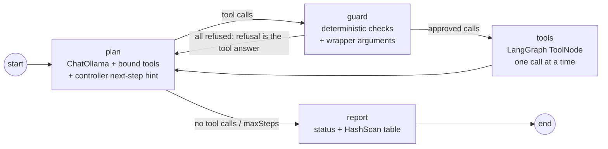

# CashETH seller agent (LangGraph + Ollama)

A local LLM agent that plays the whole CashETH story on Hedera testnet in one run:

1. **Discover.** It wants the HBAR price from the teammate's x402 API (`casheth-paid-apis/`, live on Cloud Run). `GET /price-feed?symbols=HBAR` answers `402 Payment Required` (0.50 USDC). It has no working capital.
2. **Raise credit.** Through the CashETH MCP tools it uploads a fresh invoice (`PO-<unix seconds>`, a new PDF per run), uploads the receivable, asks the **buyer** (a separate agent with its own key) to confirm it, reads the quotes, opens the credit facility and sets a budget for its research worker.
3. **Buy.** Its research worker reserves 0.50 USDC, pays the API over x402 (co-signed spend wallet) and commits the payment. The agent reads the price.
4. **Settle.** It asks the buyer to repay, checks the receivable is `Repaid`, and writes a summary with every HashScan link.

The model is `qwen3:8b` on a local Ollama, driven by a LangGraph `StateGraph`. It authenticates as the **seller account** (`SELLER_*` in `.env.accounts`) and, for spending, as the seller's **research worker** (`WORKER_RESEARCH_*`), through the same `AgentClient` the scripted agents use (OAuth JWT-bearer with a KYA-signed assertion).

## The graph



State (`src/state.ts`): the messages, the **facts** the run established from tool results (paywall, receivable id, pending id, reservation ids and spend, x402 settlement, repayment tx, `Repaid`), the calls the guard approved, the audit list, the step count and the status.

Tools the model sees (`src/toolset.ts`): `upload_invoice_document`, `upload_receivable`, `get_receivable_status`, `get_quotes`, `open_facility`, `set_budgets` (seller session); `reserve_spend`, `pay_x402`, `commit_spend` (research worker session); and three local tools: `http_get` (free GET on the paid API only, no redirects, 16 KiB cap, decodes the x402 `PAYMENT-REQUIRED` header), `request_buyer_confirmation` and `request_buyer_repayment` (delegated to the scripted buyer agent in `@casheth/agents`; the model never holds the buyer key). The CashETH tool schemas are generated from each session's `tools/list`.

## What the LLM decides vs what code enforces

| Decided by the LLM | Enforced by code |
|---|---|
| Which tool to call next, and when to stop | `maxSteps` (default 30) ends a looping run with `status: max_steps` |
| The arguments it writes (ids, amounts, budgets, URLs) | Idempotency keys come from run id + step + call index, never from the model (`src/keys.ts`) |
| How to react to a refusal or tool error | `reserve_spend` above the per-run spend cap (default 1 USDC) is refused before it reaches the server |
| The final summary | `pay_x402` / `commit_spend` only for a `spendId` reserved in this run; `pay_x402` only to the paid API's origin |
| | The buyer confirms only the upload made in this run and repays only the receivable this run financed, for its face amount from the server's typed data |
| | The worker, its spend wallet, the seller address and the invoice file are pinned by the wrapper; merchants given as Hedera ids (`0.0.x`) are converted to long-zero EVM addresses |
| | `http_get` refuses other origins and never follows a redirect |
| | The run counts as `completed` only when `get_receivable_status` returned `Repaid` |
| | Keys stay in the MCP clients and the buyer wallet: never in prompts, tool schemas, results or the transcript (tested) |
| | Behind all this, the CashETH server's own checks: token scopes, KYA, budgets, merchant allowlist, policy co-signer |

A small local model loses track of a twelve-call plan, so the plan node also shows a deterministic **next step** derived from the facts (`src/hint.ts`), e.g. `phase 3: call pay_x402 with {"spendId":"0x…","url":"…"}`. The model still chooses and makes every call; if it errs (a mistyped URL, say), the guard refuses and it corrects itself.

## Prerequisites

- Node 22, pnpm, `pnpm install && pnpm -r build`.
- Ollama with the model: `ollama pull qwen3:8b` (`ollama serve` if it is not running).
- `.env` and `.env.accounts` from the project owner (seller, research worker and buyer accounts, registered and KYA-levelled).
- The CashETH servers with the demo key flag and the paid API admitted as a merchant origin:
  - `AGENT_KEYS_IN_PROCESS=true` (the server signs `set_budgets` and `pay_x402` for the demo agents),
  - `MERCHANT_ORIGINS=0.0.11333304=https://casheth-paid-apis-177290233934.asia-southeast1.run.app` (docs/API.md section 6).
- Testnet balances: lender strategies that can fund the invoice (default 2.00 USDC face, 75% advance) and at least 2.00 USDC on the buyer to repay.

## Run

Servers already running (start them with the variables above):

```bash
AGENT_KEYS_IN_PROCESS=true \
MERCHANT_ORIGINS=0.0.11333304=https://casheth-paid-apis-177290233934.asia-southeast1.run.app \
  pnpm -F @casheth/auth start     # terminal 1
AGENT_KEYS_IN_PROCESS=true \
MERCHANT_ORIGINS=0.0.11333304=https://casheth-paid-apis-177290233934.asia-southeast1.run.app \
  pnpm -F @casheth/mcp start      # terminal 2
pnpm seller-agent                 # terminal 3 (= pnpm -F @casheth/seller-agent start)
```

Or let the agent start them (reuses `agents/src/demo/servers.ts`, which also sets `AGENT_KEYS_IN_PROCESS=true` and starts the local merchant on :3003):

```bash
MERCHANT_ORIGINS=0.0.11333304=https://casheth-paid-apis-177290233934.asia-southeast1.run.app pnpm seller-agent --start-servers
```

Options (flags win over the environment):

| Flag | Env | Default |
|---|---|---|
| `--model` | `CASHETH_LLM_MODEL` | `qwen3:8b` |
| | `OLLAMA_BASE_URL` | `http://localhost:11434` |
| `--paid-url` | `SELLER_AGENT_PAID_URL` | `https://casheth-paid-apis-177290233934.asia-southeast1.run.app/price-feed?symbols=HBAR` |
| `--max-steps` | `SELLER_AGENT_MAX_STEPS` | `30` |
| | `SELLER_AGENT_SPEND_CAP` | `1000000` (1 USDC in units) |
| | `SELLER_AGENT_INVOICE_USDC` | `2.00` |
| `--start-servers` | | off |

`CASHETH_LLM_MODEL` is also read by the MCP server for invoice field extraction; leave it unset unless you want both to use the same model.

## What to expect

Each node transition and tool call prints live:

```
[plan #8] -> reserve_spend {"amount":"500000","id":"0x…","merchant":"0.0.11333304"}
[guard] approved reserve_spend
[tools] reserve_spend ok https://hashscan.io/testnet/transaction/0x…
[plan #9] -> pay_x402 {"spendId":"0x…","url":"https://casheth-paidapis-…"}
[guard] refused pay_x402: URL_NOT_ALLOWED
[plan #10] -> pay_x402 {"spendId":"0x…","url":"https://casheth-paid-apis-…/price-feed?symbols=HBAR"}
```

then the status, the receivable id, the x402 settlement and the repayment, the agent's own summary, a table of every HashScan link, and the transcript path: `seller-agent/runs/<run id>.jsonl` (gitignored; one JSON object per node update). The exit code is 0 only when the receivable reached `Repaid`. With qwen3:8b on an M4 Pro the full loop takes about two minutes of model time plus the testnet transactions.

## Tests

`pnpm -F @casheth/seller-agent test`: no network, no Ollama, no testnet. A scripted chat model, fake MCP sessions built from a fake `tools/list`, a fake buyer and a fake fetch cover the routing, the full story, every guard rule, idempotency keys, `maxSteps`, `http_get`, the generated tool set, the hint and that secrets never leak.
